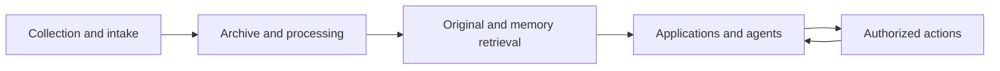

# Current architecture map

**English** · [简体中文](architecture.zh-CN.md)

These responsibility groups map current code. [Product](product.md) and [Design](design.md) describe the long-term direction.

Central owns the shared archive, processing and retrieval, and submitted conversation, task and action state. Clients own local collection, privacy processing, offline persistence and synchronization, and authorized device capabilities.

Material can be retrieved directly while Memory and interpretations are produced under authorization. Plugins, models, configuration, execution and diagnostics support the entire path.

## Responsibilities and entry points

| Responsibility | Current content | Code entry points |
| --- | --- | --- |
| Collection and intake | Mac / Android collection, explicit records, source synchronization and Central intake | [desktop](../apps/desktop), [android](../apps/android), [ingress.ts](../apps/server/src/ingress.ts), [sources.ts](../apps/server/src/sources.ts) |
| Archive and processing | Originals and versions, Material, decoding, image and audio processing | [materials.ts](../apps/server/src/materials.ts), [evidence-archive.ts](../apps/server/src/evidence-archive.ts), [plugins](../apps/server/src/plugins) |
| Memory and retrieval | Memory extraction, review and publication; material, memory and original reads | [memory-pipeline.ts](../apps/server/src/memory-pipeline.ts), [context-query.ts](../apps/server/src/context-query.ts), [evidence-reader.ts](../apps/server/src/evidence-reader.ts), [agent](../packages/agent) |
| Assistant applications | Main conversation, tasks, matters, suggestions, feedback and notifications | [web](../apps/web), [assistant-tasks.ts](../apps/server/src/assistant-tasks.ts), [assistant-notifications.ts](../apps/server/src/assistant-notifications.ts) |
| Action execution | Connected Todo, calendar and messaging product commands, authorization, targets and results | [assistant-actions.ts](../apps/server/src/assistant-actions.ts), [assistant-drafts.ts](../apps/server/src/assistant-drafts.ts), [actions.ts](../apps/server/src/actions.ts) |
| Shared foundations | Plugin contracts and host, models, configuration, execution, shared types and diagnostics | [plugin-sdk](../packages/plugin-sdk), [plugin-host](../packages/plugin-host), [plugin-api](../packages/plugin-api), [model-agent.ts](../apps/server/src/model-agent.ts), [execution-engine.ts](../apps/server/src/execution-engine.ts), [shared](../packages/shared), [diagnostics](../packages/diagnostics) |

[host.ts](../apps/server/src/host.ts) is the Central composition root. Existing assembly, features and plugins connect domains. Extensions reuse the existing SDK, models and task infrastructure. Interfaces and implementation evolve with actual needs.

## Technical foundations

- Central uses Node.js / TypeScript and Fastify; Web uses React. Mac uses Electron and native helpers; Android uses a native Kotlin client.
- The MVP defaults to SQLite and file archives, with FTS5 full-text search and optional semantic retrieval. Keep originals, published Memory and task state distinct from rebuildable indexes, retaining the existing storage and retrieval extension boundaries.
- Runtime adapters connect DSH and Codex under the same Mote context and authorization principles. DSH ecosystem compatibility prioritizes unchanged packages, followed by general configuration and composition adapters. Native applications may retain internal sessions and workflows, with Mote connecting authorized context, visible state and artifacts.
- Plugins use the existing Cordis, PluginHost and SDK. Composition depends on actual platform support and dependencies; new OS primitives ship with client builds.

## Current boundaries

- Central, macOS and Android are formally supported. iOS has an experimental client outside the formal support matrix.
- Originals, structured material, Memory, conversations and task state are distinct. Receipt does not establish parsing, indexing or Memory completion.
- Queries, Memory and insights currently use read-only context tools. Product commands and Actions perform external effects. Dedicated runtimes such as import have their own tool boundaries.
- A module or request selects its model configuration. Central stores metadata, indexes and archives, with source identity, versions and current permissions controlling reads and publication.

## Product direction and implementation gaps

| Product direction | Current implementation and gap |
| --- | --- |
| Main conversation, background tasks and authorized actions | Messages still queue per conversation and tasks produce drafts tied to archive evidence. User steering, current instructions without archive evidence, lightweight recording/onboarding and authorized Actions still need wiring. Message sends still require individual confirmation; external Agent Action access is not connected. |
| Notification delivery | The current MVP retains Android polling while the app process is alive, without background push. Online presentation does not establish timely delivery while the phone is idle. |
| Default retention and synchronization | Snapshot defaults, Central/client quotas and acknowledgement/7-day cleanup still differ from indefinite retention. Meeting recordings also have upload-then-delete paths. Larger files, lightweight records after local cleanup, deletion that blocks old retries but permits new source versions, and pending uploads after scope narrowing still need work. Day-based material retention is outside the current MVP scope. |
| Memory use and lifecycle | Replace mandatory independent review with review chosen by the model or selected memory implementation, without handcrafted semantic routing. Distinguish memory use from original quotation. Preserving valid memory after original cleanup and processing authorized paused backlogs still need work. Align context and clarification with reasonable judgments, subject/provenance retention and fewer interruptions. |
| DSH ecosystem compatibility | Native package, Hook and Factory interfaces exist, but the [official composition](../packages/agent/src/official-composition.ts) selects query tasks with empty native module lists. Production assembly of complete agents, native pages and persistent applications remains incomplete. |
| Plugin production activation | General processing service packages now validate declarations in an isolated host scope and publish them into the existing processor runtimes only after explicit enablement; failures block activation and disable fences late outputs. Pure domain installation and installed external pages/theme/layout loading remain incomplete. See [Plugin Center](plugin-center.md). |
| Source connection and coverage | Notion/Slack/Feishu-session packages have backend routes and catalog cards, but account/scope UI is missing. Source coverage is separate from execution state. Notion database enumeration resumes from durable checkpoints and rejects stale scope writes; database bodies, child blocks and Slack/Feishu-session continuation remain incomplete and must report partial coverage. Google/Lark cloud calendars enter the Action registry after separate write consent; execution requires an exact calendar and input-source grant. See [connectors](connectors.md). |
| Media preparation | On supported Macs, local-image pages prepare dependencies and model assets; optional inference is enabled separately through the plugin. Default audio pages follow FunASR/CAM++ and no longer offer unsupported WeSpeaker installation. Full journey, real-model quality and platform evidence remain separate. |
| Android advanced media operations | Common reading, playback and text correction stay native; advanced speaker review, original comparison and model preparation will open the same Central's Web through lightweight contextual entries. Those entries are not connected yet. Dedicated automatic photo-library collection is a later roadmap item, beyond current manual photo/file intake. |
| Coding dialogue coverage | The current conversation projection admits human messages and protocol-confirmed final replies only. The confirmed visible-intermediate-text direction still needs integration, without opening tool bodies or internal reasoning. |
| Execution and extensions | Generic batch processing and older delegation coexist. Reuse task foundations and consolidate duplicate state progressively as real work requires. MVP interfaces may evolve without blanket host, delegation or interface freezes. |

Update this map as implementation changes. Keep necessary short references for protocols, the plugin SDK, configuration, deployment and verification; code and schemas own concrete interfaces.

Technical references: [material and sources](materials.md#publication-and-extension), [Memory](memory.md), [execution](agent-runtime.md#execution-state-and-recovery), [protocol](protocol.md), [configuration](server-configuration.md), [content storage](content-storage.md).
