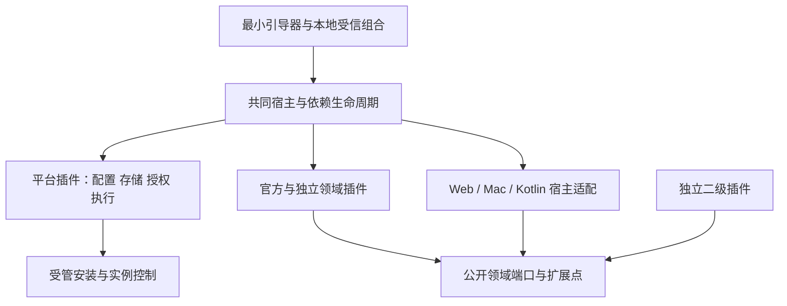

# Mote 原生插件架构与现有能力归属（H01）

日期：2026-11-02。范围：H01 的架构决定与迁移清单；公共类型和 schema 实现由 H02 接续。本文描述目标合同，不表示插件迁移、真实消费者验收或发布资格已经完成。独立架构审查结论、执行进度和检查结果记在本任务 PR/CI，不在本文建立另一份进度台账。

依据为 Owner 授权的《20261102 全面插件化实施计划与并行验收 From Codex GPT 6 astra》（下文“实施计划”），尤其第 1–6、8、10–13 节及 H01–H17 卡。计划基线是 `0d1e9c312b626d7622f98a06828c20ce1241ba88`；本次源码清点基线是 main `e96a74c94f72d72d427487485039ae56b72318f5`。两者只差 `packages/agent/src/codex-session.ts` 和对应测试：授权图像通过同一 active turn 的 steer 递送，并拒绝递送期间的异常完成。A12 迁移须保留这条当前路径，不能恢复成只返回动态工具图像的旧假设。

## 1. 决定与完成边界

Mote 默认产品由插件组合而成。全部现有平台、业务、Agent、界面和设备能力进入共同的描述、依赖与生命周期机制。插件负责创建、提供、启动和关闭自身对象；把 `buildApp` 已创建的对象传给 `provide()`、移动目录或仅包装 HTTP 路由，均不足以完成迁移。

保持 [single-owner MVP](../adr-single-owner-mvp.md) 和[三端 UI 决定](../adr-ui-final-three-clients.md)：单实例、单 Owner、多设备/来源/Agent 客户端；单一当前 wire/storage 格式；当前格式备份恢复和正常重启仍可用。无多人账户、旧格式 reader、双写或历史格式迁移。模型解释语义并选择检索工具；确定性授权、传输、去重、保留和计量保持宿主/领域职责。

默认安装必须包含现有来源、资料、Memory、Ask、发现、Action、设置及 Mac/Android 能力。普通用户无需拼装依赖树。缺少模型配置或 OS 授权时保留原有可读/离线能力与明确状态，不伪造已验证、已运行或外部效果成功。裁剪组合只影响其真实依赖：移除 Memory/Ask 不应连带破坏合法采集与原件阅读；缺唯一存储或授权 provider 则拒绝依赖启动，不能回退到隐藏实现或开放未认证服务。

来源、工具、普通业务和 UI 贡献尽量运行中启停；存储、执行、授权等基础插件允许部署/重启替换，不要求在线多代数据库共存。Web 支持完整自定义页面；Mac/Android 提供通用资料阅读、配置、状态和受支持操作，新 OS 原语随客户端构建发行，不热下载任意原生代码。不自动建设另一数据库/任务引擎、商业市场、iOS、恶意本地代码沙箱或新增业务授权。

## 2. 宿主、平台与领域的责任

| 层次 | 可以拥有的对象与职责 | 必须交给其他 owner 的职责 |
| --- | --- | --- |
| 最小引导器（H05/H14） | 进程信号、启动参数/私有 profile 定位、安全读取本地受信组合、最初错误输出、宿主构造、依赖排序、未开放业务的 HTTP 容器和通用挂载原语 | 不创建 Store、SourceStore、MemoryPipeline、Collector 等业务/平台对象；不能用 bootstrap health 暴露资料或绕过鉴权 |
| 共同宿主（H03–H06） | Cordis effect/inject/provide 适配、包/实例/贡献描述、版本检查、作用域、服务选择、能力 snapshot、撤销和失败传播 | 不理解阅读复习等领域，不持业务队列/配置权威；事件通知不替代持久 ExecutionEngine |
| 受信平台插件（C02–C08） | 各自配置、存储、授权、执行、控制与诊断服务的 factory 和资源；明确的高信任底层权限 | 不把任意 SQL、全局 Store 或密钥放入普通 SDK；不代写领域算法，不复制领域状态机 |
| 业务/Agent 插件（C09–C27、A 系列） | 对象 factory、声明依赖、业务配置/状态、任务/工具/recipe/路由贡献及撤销、资源关闭 | 不绕过公共端口取得主库或私有全局对象，不自行铸造授权、执行回执或最终 QueryResult 权威 |
| 客户端宿主与 UI 插件（U 系列） | 壳的 window/Activity/route/权限调用原语；插件持 controller、草稿、订阅、资源和受支持原生 provider | 页面隐藏只关闭读取 scope；不误杀独立 durable 工作，不将一次安装/配置视为外部效果授权 |

平台实现可接触其声明并获信任的底层能力；官方业务与外部业务消费相应同一公共领域端口。信任等级不同不表示所有插件都能操作主库。第三方自建/明确信任代码沿既有政策运行；TypeScript 类型、子进程、tool guard、fetch 包装及页面消息桥各自只保护受控路径，不构成任意代码安全沙箱。

完整默认组合只选择包、贡献及初始实现，不成为第二份 Memory Recipe、来源 binding 或 DSH Profile 权威。Central/Web/Mac/Android 各自声明实际平台支持；一包可含多平台贡献，不支持项必须可见。保持组件独立版本，协议不匹配明确拒绝，不引入旧 reader。

当前发布 `pluginManifestSchema`（worker/entry/archive/capabilities/configuration）与 `FeatureManifest`（id/version/components/requires）是两套不同用途的描述。H03 收敛为 `plugin-api` 中唯一规范包 Manifest：保留固定 release tag/commit、archive digest、来源身份、配置、trust、运行位置、精确依赖与多 contribution。FeatureRegistry 和 UI/native 描述均从其贡献投影，不再手写第二份包权威；U01 扩贡献描述/平台 DTO，不把现有 FeatureManifest 当另一包 schema。旧入口同批切到当前格式，不添加旧 reader 或双写。preview 只解析元数据，不 import、调用模型或扫历史；resolve/install/verifyInstalled 的路径、尺寸、entry、摘要、缓存重验和操作重放保护保留，官方/外部用同一规则。

## 3. 公共合同的责任与生命周期

H02 先交可审版本的最小合同，H03/H04/H06、C01、A01/A02、U01/U02 再补各自语义与真实使用样本。以下为职责决定，不抢先规定尚未实现的类型签名。

| 合同 | 唯一语义 owner / 实际消费者 | 最小保证 |
| --- | --- | --- |
| 身份、服务引用、能力、错误与 snapshot | H02；H03 实现描述；C/A/U 消费 | 包、安装、实例、贡献/API 版本及运行位置分开；引用绑定具体实现/有效 scope；不可用原因可序列化且不含秘密 |
| 生命周期与依赖 | H04；H05 装配；所有 factory 消费 | prepare/start/quiesce/stop/dispose 职责明确；重复关闭幂等，部分初始化失败释放已取得资源，关闭失败向调用者可见 |
| 单选/集合/有序链与领域扩展点 | H06；领域及 UI/Agent 消费 | 单选显式绑定；集合有命名空间；链有可解释顺序；依赖缺失/版本不兼容激活前失败，不按安装顺序抢占 |
| 实例状态与 checkpoint | H17；C02 仓储、C07 安装身份；来源/新领域消费 | Host 注入 namespace，不信调用方 instanceId；get/list/CAS、大小限制、冲突、当前格式备份/删除；不开放 SQL |
| 存储与领域 repository | C02；各 C owner 抽取实际 repository | 控制/任务 schema 在选定 storage provider；领域 SQL 可在其受控分模块；原子更新与提交 fence，只有一个实际数据权威 |
| 请求/模型/数据授权 | C04；C/A/U 受控调用 | owner、collector、MCP 身份各守范围；敏感发送与提交重新核验当前权限，空 scope 是 deny-all；缺授权 provider 不放行 |
| 持久执行 | C05；所有后台任务 owner | 使用原 ExecutionEngine/任务与操作身份；stop admission、cancel、drain、receipt/unknown 保持，不另建调度权威 |
| Runtime/Model/Host 输出 | A01/A02/A04/A09；DSH、Codex、Central | runtime 与 model 正交；普通配置对新 run 生效，已接纳 run 固定版本排空；Host 单独裁决输出、证据递送与终态 |
| UI/设备 DTO 与页面生命周期 | U01/U02；C/A producer、Web/Mac/Kotlin consumer | 跨端是 schema DTO 和有限命令，不传 Node 对象/函数；精确实例依赖、可挂起 view、草稿/返回票据、平台支持与实际 receipt |

UI/设备可用性至少能区分 active、依赖不可用、requires-build、平台 unsupported、撤权及等待设备；与 installed/desired/observed、verified/unknown 是不同事实，不把现有 `CapabilityState` 三值冒充完整可用性。必需 native provider 缺失显示 requires-build，OS grant 缺失仍走权限状态，不等同需要构建。U01 定义版本化贡献元数据及有限命令/依赖，U23 投影随 build 注册的实际 provider 与实例 binding；U02 冻结 draft/return 生命周期。具体枚举/字段由 H02/U01 共同收敛，分域提案尚非已冻结 API；现有 `ui-page` 是屏幕证据格式，不改作 UI schema。

创建权、注册权和关闭权归同一插件 scope。`prepare` 校验依赖并取得可回收资源；`start` 才接纳工作/发布可用贡献；`quiesce` 停新准入和定时器；`stop` 取消/排空受管工作并撤销提交资格；`dispose` 反向释放回调、监听器、连接、子进程和注册。若领域允许固定版本工作排空，必须保持其依赖资源到排空完成。撤权、删除、显式停止及安装身份失效优先于排空许可；取消信号不能单独证明不合作任务已经失去写资格。

当前 [ServerResources](../../apps/server/src/server-resources.ts) 先运行 `beforeClose`，再反向释放 `defer`，聚合清理错误；[ServerFeatureScope](../../apps/server/src/feature-host.ts) 已有 timer/pending/retire。迁移保留这些实际保证并消除重复 owner，不另造 DI 容器。依赖 unavailable 只是一份投影，必须伴随实际 stop/dispose、敏感调用检查和晚到提交拒绝。卸载一个插件不关闭兄弟 scope。

基础启动顺序为：本地受信组合 → 配置/存储/授权/执行平台 → 读取同一持久安装控制意图 → 业务与客户端贡献。PluginCenter 依赖数据库/执行，但平台初始选择不依赖 PluginCenter 已经运行，避免初始化环。HTTP 容器可先构造，资料/业务请求只有在所需授权和依赖就绪后才可访问。

升级先准备新实现，失败保留当前有效实现；激活/停止由 C07 的持久控制状态与 Host scope 协作，不创建第二控制器。停用保留历史与状态；卸载代码、删除实例数据、隐私 forget/revoke 和备份恢复是不同动作。旧安装身份及旧 scope 不能借晚回结果写回，新安装不能继承旧 scope 的授权。远程 write/erase/Action 未知结果保持 unknown，依现有 operation/digest/receipt 核对，close/cancel 不代表远端回滚。

## 4. Central 现有功能与实际对象清单

当前 [buildApp](../../apps/server/src/app.ts) 创建主要对象，[25 项 feature](../../apps/server/src/features/index.ts) 注册 HTTP 及部分 timer/close，[FeatureServices](../../apps/server/src/feature-services.ts) 注入内部对象。下面每行给出终态 owner；多个 C 卡表示分开的对象 owner，不表示共同创建或关闭同一实例。目标名称为职责分组，最终包/贡献 ID 由 H03 固定。

| 当前 feature | 目标插件/实际消费者 | 对象与创建、启动、关闭责任 | 迁移 / 验收旅程 |
| --- | --- | --- | --- |
| `mote.activity` | activity；Web/Mac/Android work、Agent 只读工具 | ActivityProjection/Operations 投影与 AutomaticActivity 的 timer/query；当前 app 创建、processing wrapper 部分关闭，终态 C26A 单独持有 | C26A；J01/J20 |
| `mote.files` | files；上传、播放器、原件/Agent reader | FileStore/FileEvidence/FileRawReader、附件 session、上传 ACK、playback grant/sweep；只借 C02 blob，C11 统一关闭 | C11；J01/J03/J20 |
| `mote.actions` | actions；Web/原生执行、任务 pack | Actions、ManagedCalendar、Todos、provider/delivery/grant/receipt；C25 持 tick/停止/排空，query 工具不获执行端口 | C25；J17 |
| `mote.connections` | authorization；所有请求/设备/Agent | Connections、token/login、identity closure、init/撤权/close；当前 app 创建并 init/close，终态 C04 | C04；J02/J04/J08 |
| `mote.system` | diagnostics/updates；状态与系统设置 | health/status/build-info/update service；最小不可读资料的 bootstrap health 可留 H，其余对象归 C06 | C06；J19/J20 |
| `mote.storage` | storage / retrieval / publication；所有仓储消费者 | Store/ContentStorage/ArchivedFileStore/Maintenance C02；Indexer C19C；Memory export/backup C24；不由 storage wrapper 共关索引 | C02/C19C/C24；J07/J19 |
| `mote.capture` | capture；设备 intake、library | Ingress、capture receipts/limits/browser 与 perception 调度接点；C10A 持收件，C18 持图像对象，C02 持 maintenance | C10A；J01/J02/J15 |
| `mote.context` | evidence；精确 reader、Agent tools | 唯一 EvidenceReader/contextTrees/SourceContextStore/lineage；C19D 聚合，A08 仅消费只读端口 | C19D；J01/J08 |
| `mote.materials` | materials；library、processing、Memory | MaterialStore/revision C19A，Organizer/backlog C19B，索引 C19C，Memory 候选账本 C19E；各自 factory/close | C19A–E；J03/J20 |
| `mote.coding` | coding source/organizer；资料与 understanding | 当前 `codingSourcePlugin` 直接传 SourcePipelineRuntime；recipe/archive 投影归 C09，材料组织归 C19B，语义调用消费 Agent | C09/C19B；J03/J20 |
| `mote.sources` | sources/pipelines/connectors；配置、同步、处理 | SourceStore/capture context C10；pipeline/archive/recipe/fence C09；registry/OAuth C12；各连接器独立实例 | C09/C10/C12；J02/J05 |
| `mote.models` | config + Agent runtime；模型设置与执行 | ModelSettingsStore/ConfigService C03；ReloadableAgent/runtime/model factory A09/A10；watcher/lease 各自关闭 | C03/A02/A09/A10；J08/J10/J16 |
| `mote.processing` | processing；文件/材料/Memory | ProcessingRuntime/FileProcessing/context & file processor registry C17；媒体对象 C18；AutomaticActivity 归 C26A，不能重复 close | C17/C18/C26A；J03 |
| `mote.notes` | notes source；三端记录/逐轮保存 | 当前路由调用 Store/Ingress；C10B 抽出 note 创建/删除与原件引用，不为 note 另建底层库 | C10B；J01/J13/J15 |
| `mote.devices` | devices；心跳/首次数据/能力状态 | 当前直接读写 store；C10C 持 device scope 和统计投影，设备 provider 归 U23 | C10C/U23；J02/J14/J15 |
| `mote.media` | media；媒体状态、播放、处理 | MediaAssets C18A、MediaPreparation/OCR/ASR C18B、ImageProcessing/recipes C18C；worker/config invalidation/download/close 随 owner | C18A–C；J03/J20 |
| `mote.owner-questions` | owner questions；Memory 续写和 UI | OwnerQuestions 仓库/HTTP C26C；Memory question/answer/withdraw 消费、续写与委派 C22 父卡，保持一个实际实例 | C26C/C22；J06 |
| `mote.memory` | Memory 四类插件；Memory/Ask/Insight/reader | C21 策略/仓库/准入/绑定；C22 phase/lifecycle/topics/续写；C23 provider；C24 publication/retirement/deletion/backup | C21–C24；J06/J07/J18 |
| `mote.imports` | import workflow；Web/native preview、Agent import | ImportStore/source packs/manifest/任务 map C20；上传 session C11；Agent factory A14；scope 管理 task set/cancel/restart | C20/A14；J03/J10 |
| `mote.ask` | query/conversations；三端 Ask 与 Host delegation | Conversations/DelegationRuntime/DelegatedQueryRuns/prepare/commit C27；runtime/output/tools A04/A08/A12；C27 关闭 journal/run，A 关运行资源 | C27/A 系列；J08/J10/J13 |
| `mote.usage` | usage；设置、模型计量、operation view | UsageLedger 与 admittedUsage closure C06；A10/A11 消费真实 admission/usage，不因未发模型请求虚构费用 | C06/A10/A11；J16/J20 |
| `mote.insights` | insights；发现/报告/自动任务 | InsightRuns、snapshot、insight query closure C26B；C22B 只安装/撤销其 lifecycle 接点 | C26B/C22B；J06/J20 |
| `mote.diagnostics` | diagnostics；support/状态/运维 | ServerDiagnostics/init/close、eventLoop、executionObserver 与脱敏写入 C06；不把正文/token 输出到公共状态 | C06；J20 |
| `mote.agent-view` | Agent read projection；外向 Agent 设置/inspector | C26 父卡持中央分页/视图，A08/A17 提供 registry/progress snapshot，不新建 runtime | C26/A08/A17；J08/J20 |
| `mote.features` | plugin discovery/control；三端插件中心 | C08 将共同 Host snapshot 投影为 API，退出 feature-inventory 手工拼 registry；安装事实与实际可用性分开 | C08/H04/H14；J02/J19/J20 |

下表补足不由 25 个入口名表达的资源与 factory 接缝。

| 具体对象组 / 当前实际生命周期 | 终态唯一 owner、依赖与释放 | 实际消费者 / 迁移 / 旅程 |
| --- | --- | --- |
| ConfigService initialize/startWatching/close、ExecutionSettings、ModelSettingsStore initialize/close、validator/onChange | config C03；依赖 bootstrap 原始位置/secret 与 storage；注册业务 domain/validator/watch 的 owner 必须一同撤销 | 全 factory、三端配置；C03；J19/J20 |
| Store、SQLite/schema、archive/content encryption/quota/retention、MaintenanceWorker | storage C02 从 factory 创建并最后关闭；领域 repository 由各 C 卡抽取到受控分模块，业务不保留 `Store.db` 后门 | control/execution/所有领域；C02；J07/J19 |
| BackgroundModelAuthorization、ModelAuthorizationHost、evidence/processing authority、request identity | auth C04 创建/绑定/撤销；发送和提交时 fresh revalidation；不能由 Agent 维护第二授权表 | processing/Memory/Query/model transport；C04；J04/J08 |
| ExecutionEngine、ProviderAdmission、agent/LLM/interactive lanes、ConcurrencyGate | execution C05；依赖 C02/C04；先停新任务/transport，取消并 drain，存储与 handler 最后释放 | 所有 durable 工作与 Agent admission；C05/A11；J04/J19 |
| PluginCenter、GitHubPluginReleases、WorkerPluginRuntime | C07 持持久操作/安装与 adapter；H03→H09 持 resolver/制品检查；C08 持 HTTP 投影；Host 持 scope | 所有包/实例、U09；C07/C08/H09；J02/J04 |
| source pipeline ready/tick/close、SourceStore、Ingress、coding recipe、connector builtins | C09 pipeline 唯一权威；C10 SourceStore/Ingress factory；C12 注册与 credentials/OAuth 生命周期；C13A Calendar、C13B Gmail、C14 Lark、C15 Feishu/DingTalk recordings、C16 MCP | C17/C19/C20/Memory 与来源 UI；J02/J03/J05 |
| processing initializeConfiguration、semantic/conversation processor registrations、capture-memory-intake | C17 registry/executor；C18 media；C19E intake/候选账本；注册 disposer 随贡献撤销；不创建第二账本 | 材料/Memory/导入；C17/C18/C19E；J03 |
| MemoryStrategies/RecipeSettings、MemoryStore、Automation、Bindings/control、IntegrationSettings | C21A policy/settings，C21B repo，C21C freeze/admission，C21D namespace/binding 状态机；依赖 config/storage/auth/control；旧 scope 无新提交资格 | C22/C23/C24、UI、Agent task pack；J06/J07/J18 |
| MemoryPipeline、ReviewCache、Lifecycle、WorkingMemory、TopicsHost、extensions、owner continuation/delegation | C22A phase/review/cache，C22B lifecycle/working，C22C topics；C22 父持续写/委派；先关 timer/接纳，再 drain/cancel 和撤销注册，保留提交 fence | Memory/Ask/Insight/OwnerQuestions；J04/J06/J07 |
| MemoryAdapters/Mem0/Hindsight/worker、prepared stage、authority/usage map | C23 持固定 namespace/config identity 下的 worker/provider 与清理；A10 提供 model transport；未知远端结果交 C24 durable reconciliation | C21/C22/C24；J07/J16 |
| MemoryPublication/private storage/deletions/retirement/provider backup/archive export/evidence deletion | C24 实际迁发布、未知写擦、revocation/native cleanup 与备份注册；C02 提供事务/schema 安装设施，H17 接通用状态备份 | 当前已发布记录、reader、C30 恢复；J07/J18 |
| Fastify/CORS/static mount、Cordis root、ServerResources、agentFeatures | H05/H14 仅保留通用容器/挂载/依赖生命周期；C04 提供 auth enforcement；A08→A17 持真实 tool/session pack；U03/U26 持 Web UI 贡献 | 真启动与各业务请求；H04/H05/A08/U03；J01/J08/J20 |

领域只读核对补足的接缝如下，均属于现有功能迁移：

- `features/connections.ts` 内创建的 LoginHandoffs 随 C04；`features/models.ts` 由 C03 持 wrapper 写入，C04/C05/Agent 交贡献；`features/storage.ts` 由 C02 串行拆接线，C11 交 files sweep、C19C 交 index timer、C24 交 export/backup。不能照现 wrapper 划分重复 close。
- `record-context.ts` 随 C10A 的 Ingress factory，保留收件事务内 `ownerDescription` 绑定与当前身份重验；C19D 只读。`evidence-routes.ts` 随 C19D 拆出 CaptureRead/原件贡献，Memory 部分由 C21/C24 提供；`GET /api/notes/:id` 当前实际在此注册，不在 notes wrapper。`material-routes.ts`/`owner-library-browse.ts`/`source-material-view.ts` 由 C19 父卡按 C19A/D 切片接入；`capture-timeline.ts`/`device-library.ts` 分属 C10A/C10C；`library-source-view.ts`/`layers-read-model.ts` 由 C10 父卡装配并消费 C19 只读端口。
- `semantic-extraction.ts`/`conversation-understanding.ts` 和当前 app 的 `semanticArtifacts` 闭包归 C17 的 processor 贡献接缝，C19B 提供 coding lineage，Agent 提供语义执行端口；H05 仅装载接线。Actions wrapper 创建的 ActionCapabilities/ManagedCalendar 随 C25，不留在 H 引导器。
- `materials.onSourceContextChanged`、`inputs.onOriginalInput`、`conversations.onTurnReceived`、PluginCenter probe/configurationAllowed/retired/admissionChanged/references、Bindings providerFactory/onReleased/pendingTail、Automation onResume/onStop/counts、recipe settings onChange/onApplied、Publication revokeEvidence、ConfigService validator/handler/media watcher、playback authorization 与 catalog notification 都是需要 scope 持有并撤销的跨域注册；publisher 定义注册端口，实际注册的贡献 owner 持 disposer。activeQueries/heartbeat、importTasks/importAgents、Hindsight authority/usage map 也必须随所属运行 scope 收尾，不能只迁 class。

现有 `source_pipeline_bindings` 是来源选择权威，`select()` 优先显式 binding，priority 只用于未绑定默认。C09 演进既有合同，不新造绑定表；更改 storage 使用新的 source identity，不能静默 fallback 到旧 SQL 副本。材料原件/精确 revision 与 lineage 统一经 C19D reader，Note 尚无 Material 也能读，Agent 不维护第二 reader。

## 5. Agent 全量能力归属

| 当前功能/真实消费者 | 目标 owner 和对象生命周期 | 卡 / 旅程 |
| --- | --- | --- |
| Query orchestration、候选输出、校验/修复、citation/delivery ledger | HostRunSession A04 独占最终输出与终态，runtime 只交候选；原 deadline、校验及受限模型修复保留；Central C27 消费 | A01/A04/A05/A12/A17；J08/J10 |
| DSH create/resume、native package、Loop Hook/Factory | DSH provider A05；native assembly A07 持 package/hook/factory generation 与 dispose；A03 用锁定真实 SDK 本地 loop 先验风险 | A03/A05/A07；J09 |
| Codex query/import、dynamic tools/image delivery | 并列 Codex provider A12，不经 DSH；保留当前同 turn 图像 steer/取消保护；Import A14 单独 workspace grant，native multi_agent 不随迁移扩大 | A12/A14/A15；J10 |
| Model transport/options/catalog/config/reload、provider quota | A02/A09 runtime/model profile 与双 generation pin；A10 transport/secret/attempt authority；C03 唯一配置持久权威 | A02/A09/A10；J08/J10/J16 |
| 所有 context tools：原文/range/attribution、Material/Memory、Source/File、Activity/Device/Calendar/progress、image | A08 持 tool session/Host ledger/总 scope，A08A registry/schema adapter；A08B–F 各 pack factory/descriptor/disposer；只读 C19D 与各领域真实端口 | A04/A08A–F；J08 |
| 9 个 skill、6 个 profile、prompt/context/response policy | A13A registry/task assembly；A13B Ask/selected answer/working/evidence prompts；A13C Memory/coding 的五个 skill 与 extraction；A13D Insight/Calendar/Import；pack 持注册与撤销 | A13A–D/A17；J06/J08/J10 |
| Import file/shell/preview | A14 task capability 拥 workspace/runtime；C20 持 manifest/confirm/recovery；取消关闭自身运行，不赋予普通 Query 本地工具 | A14/C20；J10 |
| Host delegation/proposal/workspace | A15 独立 HostControlChannel；C27 既有 durable journal；child scope 为 parent 子集，原回执重验，grant/runtime/model 固定 | A15/C27；J10 |
| budget/cancel/deadline/usage/failure/probe/status | A11 Host run/attempt 收尾与计量；A06 最短认证 Ask；A16 三端配置及手选 live 验收；A17 退旁路与默认 pack | A06/A09/A11/A16/A17；J04/J16/J20 |

QueryAgent 永远只拿只读上下文工具；工具可发现、包已安装、profile 可配置都不是写权限。Action proposal 与实际执行分离，Import/Host control 各走其原产品授权。已接纳 run 普通配置更新按固定版本排空；撤权、证据修订/删除、显式停止、真实 grant/fence 失效必须拒绝晚到结果。DSH/Codex 真实执行能力与第三方内部不可见重试的限制如实披露，不能宣称全部逐 attempt 受控。

Agent 只读核对确认两条 runtime 当前各自执行 `pinContextTools → startBridge → systemInstructions/assembleContext`，随后 `parseAnswer(bridge.records) → restoreMemoryCoverageKeys → validateHostOutput → 有限 repair`。共享 Host 迁移保持顺序、同 session/active budget、当前最多三次 repair，以及 DSH `output_limit` 可修复的现有行为；typed terminal 不按自由文本猜失败类别。当前 `validateOutput` 是可选回调，改为必需的 Host output 基础 provider 是本次显式架构决定，缺失拒绝相关 runtime 启动。Host 独占 receipt/dependencies/contextUsage/runId 构造；C27 等领域仍持实际存储提交 fence，候选合法不等于可以持久提交。

A08B 的 exact read range 不扩大 targets；A08C 保留 Memory body disclosure/partial coverage 与 source/evidence 依赖；A08F 区分 dialogue direct image 和 archive grant，保持 hash/crop/quota/dedupe，prepared 不冒称远端模型已关注。A06/A09 的 probe 使用独立生成 reader，pending setup 和 modelOverride 临时 lease 都要关闭；A11 区分 queue/active 时间、LLM/harness 计量及 partial/unknown usage，并保留主失败与清理次失败。A15 的历史 child prose/workspace 不授 citation。

A03 只读准备仅核实 package/lock 固定 DSH rc.2，准备 worker 的 worktree 尚无该依赖安装；公开 exports、setFactory 唯一 owner、旧 factory dispose、create/resume/setup/commit rollback 与 owner unload race 均待唯一构建 owner 准备锁定依赖后用真实 SDK 验证。类型声明或 patch 文本不能作为运行证据；A03 依 A01 即可开始，不等待 A02/A04 或安装 UI，A05 再汇合其完整前置。

## 6. Web、Mac、Android 功能与后台归属

对应实施计划 CW01–CW14、CM01–CM06、CA01–CA12。表内 UI owner 必须迁 controller/cache/订阅/草稿/资源，不只迁菜单；后台 scope 独立于 view scope。

| ID / 现有功能与消费者 | 目标插件所有权、启动/释放与保留行为 | 卡 / 旅程 |
| --- | --- | --- |
| CW01 Web 壳/session/route | U03 Host 持 session/安全 transport/route stack，业务轮询归插件；view scope 可撤销；Web 保持完整 sidebar/topbar/management | U01/U02/U03/U10/U24；J01/J13 |
| CW02 home/初用/quick note/search | home/search controller/cache/pagination U11；note draft/save/attachment U06；保存/折叠回到原页/scroll/未发 Ask，未处理 Note 可见 | U06/U11；J01/J13 |
| CW03 全资料/原始记录/timeline/片段/app/media/coding | U11 collections/controllers/time cursor/订阅；完整 membership 与时区，阅读不触发模型 | U11；J01/J20 |
| CW04 exact reader/Source Material/file/audio/structured note/citation | U12 持 pinned revision/page continuation、播放器/asset 取消与 origin；literal 文本、owner addition/description 分开，正数删除回执才关闭 | U12；J03/J13 |
| CW05 文件/文件夹/ZIP/录音导入与 review/queue | U12 持 durable intake operation/part-final receipt/独立 context 草稿；4000 直选、64MiB 单项/256MiB 总额和现有 archive 规则保留 | U12；J03/J20 |
| CW06 Ask/history/clarification/citations/turn save/run details | U13 持 run/conversation、question/attachment/逐轮保存独立 draft、stream/poll；跨端同 run/citation，adopted run 无 body 只读不伪造 retry | U13/U06/U24；J08/J13 |
| CW07 Memory/topic/history/manual recipe/owner question | U14A 持列表/详情/filter、manual request/answer identity/draft/return ticket；隐私 forget/revoke 继续限制历史 | U14A；J06/J07/J13 |
| CW08 发现/report/More/自动发现/work/actions | U14B 发现请求/历史/report bridge 与 disposal；U14C activity/task/calendar controller/receipt/poller；保存信息不等于 OS 写入 | U14B/U14C；J13/J17 |
| CW09 sources/Google/Gmail/Lark/recordings/MCP/coding | U15A 持 config/reauth/sync/binding/context；U12 持内容 reader；reauth 不 resume 既有 paused source，account-wide 范围可见 | U15A/U12；J02/J05 |
| CW10 model/services/material processing/automatic grants/OCR/ASR | U15B 持 draft/CAS/dependency/download/start/recovery/authorization confirm；保存不授权、空 scope deny-all、下载完成不报可用 | U15B；J03/J16 |
| CW11 outward Agent/catalog/context preview/retained run/client login | U15C 分开 controller、显式读取 retained event/分页/取消；缺失/truncated 不重建历史，Query tools 只读 | U15C；J08/J10 |
| CW12 plugin center/config/quick add/Memory binding | U09 持 intent/revision/operation/draft/platform projection；installed/desired/observed/available 分开，未知 ACK 保留同 intent | U09；J02/J04 |
| CW13 devices/storage/vault/backup/stats/runtime/usage/diagnostics/update/preferences/help | U15C 持低频管理 controller，U10 theme/locale，U23 device projection；草稿/secret/private profile 保持 | U15C/U10/U23；J18/J20 |
| CW14 完整自定义页面与原生声明式降级 | U08 loader/能力桥持 frame/session/token/instance scope；U07 schema data/action/draft provider；仅受控命令，不传 Node/秘密 | U01/U07/U08/U09；J11/J12 |
| CM01 Mac window/background/tray/quicknote/preload/IPC/profile | U04 持通用 window/IPC/route 原语，U18 持 tray/settings 业务，U06 note controller；关窗继续后台、quit 独立，Dev private file/Prod safeStorage | U04/U06/U18；J13/J14 |
| CM02 screen/UI/app/privacy/Chrome/local browser | U16 capture/source factory 持 Collector/helper/bridge/jobs 与取消；U18A 权限帮助；OS 权限原语留 Host，exact origin read-only recheck 不申请新权限 | U16/U18A；J14 |
| CM03 folders/files/calendar/coding/source context | U16 持 LocalSourceManager/adapters/watchers/outbox/source jobs；U18A picker；本 device 与 source identity、paused reauth 和付费历史限制保持 | U16/U18A；J14 |
| CM04 native library/reader/search/Ask/Memory/work/sync history | U17A reader/cache/page/asset；U17B Ask/run/draft；U17C work/history read API/scope；隐藏停读保留 draft，不关闭 writer | U17A–C/U24；J13/J14 |
| CM05 queue/transport/backup/storage recovery/jobs | U16 持 durable transport 与 worker lanes/lease/cancel/drain；U18B 备份/恢复/retention 业务；IO 原语可 Host；confirmed/unknown 分开，不新增事务/rollback | U16/U18B；J14/J18 |
| CM06 context/settings/connection/permissions/diagnostics/update | U18A settings/CAS/preview-confirm，U18B storage，U18C update/support/tray；ConfigStore 仅安全 IO 可 Host，业务 defaults/schema/validation 归 provider | U18A–C/U23；J14/J20 |
| CA01 Android Application/Activity/home/navigation/theme/i18n | U05 Kotlin Host 持 route/activity-result/permission 原语，U21A home factory，U10 presentation；唯一 home 主导航、Record/Ask 主 action 保持 | U05/U10/U21A；J13/J15 |
| CA02 Record/photo/audio/editor/local note/attachment/description/system entry | U19 Record controller 持 recorder/player/draft/attachment/save identity 和系统入口 provider；U06 notes 链；离线先记录，不自动申请权限/配模型 | U19/U06；J15 |
| CA03 Projection/Accessibility/media/notification/system/privacy/UI/OCR | U19 持 native service/pipeline/controller/context outbox；Kotlin 管权限/重建/停止；通知 pause 仅停 screen，resume 要原 preview/consent | U19；J15 |
| CA04 sources/SAF/files/provider/worker | U20A 持 source scheduling/file archive/intake/context sync；device/source identity 不变，SAF 不变 Central 路径，source pause 与 sending 独立 | U20A；J02/J15 |
| CA05 queue/upload/negotiation/part-final receipt/history/LocalState | U20B 唯一 durable transport/receipt/retry/LocalState producer；U20A/C 只给 projection/invalidation，home/notification 订阅；隐藏 Activity 不关闭 application producer | U20B；J04/J15 |
| CA06 storage/stats/backup/dedupe/compression/debug | U20C 持 storage/backup/recovery，U22C 系统工具；私有 IO 可 Host；保留 partial/unknown，不自动重放/假回滚 | U20C/U22C；J15/J18 |
| CA07 local/Central library/Memory/exact original/search | U21B 持 reader/cache/filter/page/refresh/asset；原件优先、literal note、历史 ref 不 retarget；hidden stop reads | U21B；J13/J15 |
| CA08 Ask/conversation/image/citation/quote/turn-save | U21C 持 controller/run ticket/continuation/draft，notes command U06；同 conversation/citation、draft 分离、adopted run 无 body 不重提 | U21C/U06/U24；J13/J15 |
| CA09 home continuing/work/Memory question/discovery | U21A home projection，U22A work/discovery controller/poller/return；只显示实际 continuing，离开停 polling 保留 draft | U21A/U22A；J13/J15 |
| CA10 calendar actions/capability/worker/journal/OS | U22B 唯一 publisher/managed receipt journal/native controller；U23 只消费真实能力输出；既有 grant/version/target/device 检查与 OS readback | U22B/U23；J17 |
| CA11 admin/settings/model/processing/outward Agent/connection/onboarding | U22C 唯一 CentralAdmin 拆解 writer 与 settings/config drafts，领域 provider 各独立模块；U09 plugin center；新 native 随 build | U22C/U09；J15/J20 |
| CA12 preferences/diagnostics/logs/usage/update/install/support | U22C 持业务 provider，U10 locale/theme；Dev 不用 Keystore，Prod 保持保护；签名失败不安装 | U22C/U10；J15/J20 |

三个容易遗漏的实际生命周期：

- Mac 当前 `main.ts` 在 ready 后创建 QueueStorage/DurableQueue、LocalSourceManager、SyncHistory、Collector、ChromeCaptureBridge、diagnostics/updater；quit 发起 shutdown/settle，关窗仍后台运行。U16 持唯一 SyncHistory writer，U17C 持 API 与 read scope，U04 串行接根。隐藏 view 不 terminate 共享 worker pool；退出要 await writer drain 再 close DB，不能把当前 fire-and-forget 当终态保证。
- Android 当前 `MoteApplication` 启动 LocalStateRepository 和恢复/retention/upload/source 工作。`LocalStateRepository` 持 application coroutine、preference listener，并向 notification 发状态；U20B 接管唯一 producer 且关闭时注销 listener/cancel coroutine，Activity 只取消自己订阅。不得由 Application/UI 再建第二 producer。
- Android 当前 `RecordEditorActivity` 在明确麦克风授权后创建 MediaRecorder，在 `onPause` 停止、release 并保存草稿，播放器也 release。U19 的 Record factory 保持这条 view 录音生命周期；它不同于允许独立后台运行的 capture/transport scope。OS 授权、原生重建和系统入口仍需阶段 native 验证。

三端只读清点发现的漏列文件按下列职责补清；这是既有功能的 writer 归属，不新增任务卡或产品政策：

| 接缝 | 明确 writer / 所有权与关闭责任 |
| --- | --- |
| Mac `background.ts`/`background-worker.ts`、`queue.ts` | U16 持四条 lane 的 worker/pending futures、DurableQueue 的批次/transport producer、lease/cancel/drain；U17/U18 只消费 lease，不共关 worker |
| Mac `calendar-actions.ts`、`source-selection.ts`、`sync-content.ts` | calendar native executor/ledger 归 U16，列入 J17 Mac 实际 consumer；source picker/identity 归 U18A；sync/readCentralContent 归 U17A；均由 U04 串行接 roots |
| Mac 最小宿主文件 | `secret-storage.ts`/`profile.ts`/`response-body.ts` 的 OS/私有 IO/有界传输原语由 U04 持；`login-session.ts` 的连接续期业务归 U18A；`contracts/*` 由 H02/U01 冻结跨端语义，U04 适配；`native-status.ts` 归 U23 投影，U16 提供实际运行事实，不在壳另造状态源 |
| Mac capture/source 族辅助对象 | Chrome protocol/constants/native-host、source-types、app-capture、privacy、image-dedupe、original-spool、record-metadata、priority-scheduler、directory-catalog、file-index、ingress-protocol 随 U16 的 factory/资源 scope；系统权限/IO 原语由 U04 adapter 提供，不留下固定业务 factory |
| Web `api.ts` 与共享 view 原语 | `api.ts` U03 先持安全 transport 最小切片 → U08 串行页面桥切片；不把 P2 整卡作为 P1 前置。`unsaved.ts`/`resource-cache.ts`/useResource/useForegroundResources 为 U03 持有、服从 U02 scope 的通用原语；业务 cache/策略仍归各插件 |
| Web 草稿/记录/来源 | `chat-drafts.ts` 归 U13；`open-question-draft.ts` 归 U14A；`features/notes.tsx` 归 U06；`CodingUploads.tsx` 归 U15A，随实际业务 controller 迁移 |
| Web route/壳/轮询与 PageProps | route-query/owner-question-route/memory-source-route/workspace-focus/navigation 的跨端引用/返回语义归 U24；WorkspaceSidebar/shell-components/session/login-handoff 的通用壳/transport 归 U03，theme/layout 贡献 U10，授权操作 UI 仍归 U15C。U03 负责退出巨型 PageProps 接线；status/devices 管理读 scope 归 U15C（消费现有端口，U23 后续补能力投影，不反等 P4），activity 归 U14C，insight history 归 U14B，range/timelineRevision 归 U11 collection；各自隐藏停读。U03 只保留连接/session 状态 |
| Android transport/notes/import/壳 | `CentralClient.kt` 的有界 HTTP/错误原语归 U05；`CentralNotes.kt` 的加密 draft/outbox/同 ID ambiguous ACK 归 U06；`CentralImports.kt` 的 durable 分段上传归 U20B；`CentralActivity.kt` 壳归 U05 → U24 深链切片。共享 IO 不携业务 defaults/策略 |
| Android 状态/catalog/notification/retention | `NativeStatus.kt` 归 U23 投影、U20B 供实际本地 producer；`CentralCatalogDescriptor.kt` 归 U09；`NotificationObservations.kt` 归 U19 的 SystemEventCollector；`RetentionWorker.kt` 归 U20C，调度与 scope 停止随 storage provider |
| Android `MoteApplication` 每段编排 | U05 唯一改 root，仅调用 factory：Notifications/MediaCollectionService/Accessibility refresh 归 U19；SourceWork 归 U20A；LocalState/UploadHistoryRecovery/UploadWorker 归 U20B；QueueStorage recovering/maintaining、orphan recovery/dedupe/RetentionWorker 归 U20C。producer 重建、flags 和工作顺序由对应 provider 合同保持，不复制新旧两套调度 |

当前 Web `webFeatures` 是模块级单例，bootstrap 在 import 期安装 builtins，install/register 的 disposer 未由 bootstrap 保存，Host.close 尚无实际调用者；U03 要把这些真实创建与释放纳入启动根。当前 Mac lane 懒启动/unref 和 Android LocalState 无 dispose 也不能算已有插件关闭保证；上述 owner 实现后才可验真，本文没有将它们标为通过。

## 7. 最短真实链与风险验收

G0 交设计及合同，不运行全仓测试凑证明。G1 的第一条真实链由 H05+C29 接通，U06 接三端真实 consumer：

1. H08 的仓库外 source 包只依赖公开 SDK，在私有生成 profile/动态端口由实际默认启动入口装载；不能手动塞内部对象冒充启动，也不能改 `app.ts` 才能加载。
2. 从真实 owner `POST /api/notes` 或外部来源入口保存生成输入，记录实际原始 ID、receipt、bytes 与归属；Note 经 C10A Ingress 在事务内重验身份并绑定 RecordContext。收件的 `version:2/kind:capture/state:received` 只证明可恢复收件，不保证处理/发布；同输入重复 POST 保持同 ID 与 duplicate receipt。无认证、受限凭据越权、撤权后请求必须拒绝。
3. C09/C10B 接纳并归档；经 C19D 贡献的真实 `GET /api/notes/:id` 及唯一 reader 读取原件与稳定精确引用，不因当前聚合类型捆绑 Memory 而要求 Memory/Ask 全迁。未生成 Material 的 Note 在 notes/library browse 均可读；另一个确实产 Material 的 Source 输入经 pinned recipe/C19A publish，用真实 `/api/materials/:id/read` 与 members 核 ref/revision/range，不能把立即产 Material 当 note 保存条件。
4. 关闭、重启同 profile 后读相同 ID/原文。注入 prepare 中途失败、在途取消/撤权与晚回屏障，检查持久状态、后续可读性、无重复 poller/端口和清理失败传播；不靠随机 sleep。
5. G1 可使用真实本地固定组合，完整安装 UI 尚不计通过；G2 再走实际 install/configure/enable UI 与同包双实例，G3/G5 再核完整默认功能与实际发行产物。

| 抽查与用户失败 | 负责实现/实际验收 | 必须观察的结果 |
| --- | --- | --- |
| Memory 撤权后晚回正文复活、unknown write 重试重复 | C21C/D、C22A、C23/C24；J04/J07/J18 | 准入/namespace/config pin 和提交 fence 生效；远端 unknown 可对账，历史与隐私删除区分 |
| 采集停用后仍发送、重启双 poller | C09/C10A/C12、U16/U19/U20B；J02/J04/J14/J15 | plugin owner 真正停 timer/job/transport；同包兄弟实例继续；当前凭据/receipt 检查 |
| storage 替换仅改列表、业务仍读隐藏 Store | C02/H05/C30；J19 | 重启后真实消费者使用替换 provider；缺唯一 provider 拒绝依赖；无旧库 fallback |
| Android 录音离页泄漏、草稿丢失或越权自动开始 | U19/U05/U06；J15 | 明确授权后开始；离页 recorder/player release、草稿可恢复；capture/transport 不被 view hide 误停 |
| 新 provider 安装抢占 binding，卸载后静默换算法 | H06/C09、领域/二级插件；J05/J11 | 反向安装顺序不改变显式选择；依赖失效实际停用并拒绝晚提交，不自动选另一个 |
| 页面替换/连接切换丢 draft、隐藏仍读旧 owner 内容 | U02/U08/U24；J12/J13 | view read scope/current owner/frame identity 失效；draft/return ticket 和后台 durable scope 各守生命周期 |
| Query 因插件启用取得写权限，未递送证据产生 citation | C04/A04/A08/C27；J08/J10 | Host fresh auth/delivery ledger/最终校验；只读工具，无 shell/外部效果旁路 |

J17 的三端真实效果消费者除 C25、Web U14C、Android U22B 外，明确包含 Mac U16 的 `calendar-actions.ts`/native ledger（U18A 提供现有权限/连接 UI，U23 投影能力）。既有 EventKit/device/calendar/version/grant 检查与真实 receipt/readback 保持；未获 OS 授权或未有实际 calendar 的环境不得由 fixture 冒称 Mac 已执行。

按 [testing](../testing.md) 和 [real-world-testing](../../.agents/skills/real-world-testing/SKILL.md) 选择回归。现有真实起点包括 server 的 `notes.test.ts`、`source-pipelines.test.ts`、`backend-plugin-scope.test.ts`、`memory-publication-retirement.test.ts`、`plugin-control-journeys.test.ts`，Web 的 `feature-bootstrap.test.ts`/`feature-host.test.ts`，以及 `apps/android/test-fixtures/central-kotlin-contract.ts` 的实际 HTTP→Kotlin 消费。它们是后续风险检查入口，本 H01 未执行，也不能据此声称新路径已通过。H15 复用生成数据与可控故障；新 heavy runner 放手选目录，不进入普通 test glob。

fixture、真实 SQLite/HTTP/进程、真实 DSH SDK loop、模拟器、物理 OS 授权、真实第三方与 live model 分别报告。DSH 本地脚本 provider 可证明 hook/factory 被真实调用，不证明模型语义；JVM consumer 不证明 Android clock/meter/WorkManager。G5 对同一候选核适用 J01–J20，复用相关输入未变的成功结果，只重跑源/依赖/fixture/配置/环境使之失效的检查。

## 8. 启动、真实集成与收敛的交接

实施计划的 144 卡与第 8.4 节准确依赖索引仍是分派依据；本文按对象映射这些卡，不复制另一张状态表。启动前置是最小冻结合同/可消费切片，真实集成前置是 T3 producer/consumer 已存在，收敛前置是父卡/阶段最后闭合。未冻结前置可只读准备，不写消费假想新 API 的实现。

| 交接点 | 可以开始的条件 | 真实集成或最终闭合仍需等待 |
| --- | --- | --- |
| H01 → H02 | 本文范围/架构经独立审查并由 root 冻结 | H02 schema/错误/版本 T1 与 C/A/U 样本走查；不提前声称新 consumer T3 |
| H02 → H03/H04/C01/A01/U01 | 对应最小公共合同已冻结；同文件最终写入串行 | 各领域细化端口/实际样本；A02 再依 A01/H02/C01，U02 依 U01/H02 |
| H05 loader / C02/C04/C05/C09/C19A/D | H05 依 H03/H04；平台 factory 按自身依赖独立开始，不反等 H05 G1 完成 | H05 G1 汇合 C02/C04/C05/C09/C10B/C19A/C19D，C29/H08/H15 接首链 |
| A08 tools / A13 task packs | A08 按 A04/A05/H04/H02，子 pack 按 A08A；A13 按 A08/A12/H04 | A08 实际集成 A12/C19D，父卡等 A08A–F；A13 父卡等 A13A–D，不令父 completion 阻塞子启动 |
| C19A/D 早期端口 / C19 全量 | P1 提供唯一实际仓库/reader，暂消费当前真实索引 | P3 其余 organizer/index/intake 和全部 consumer 闭合，不能新造临时第二 reader |
| C22 phase/topics / C24 publication | C22A/C 使用冻结 publication/event 端口及各自准确启动前置 | 实际 T3 汇合 C24/A13；C22 父卡还持 owner 续写/委派并等子卡，不反向制造环 |
| 默认产品退出过渡接线 | C28、A17、U26 各核本域完整对象/消费者；H14 依这三者与 H11 | H14 删除固定业务 factory/双调度；H13 干净产物与当前协议；C30/H16 收敛恢复/原生/live/独立作者证据 |

G1 同时需要 C10 父卡 SourceStore 最小 factory 及 C10A（C10B 的准确前置）；C19A/D 只需 A01 冻结的读端边界，不等待完整 Agent。当前配置/诊断早于业务创建，即使 C03/C06 全卡主期在 P2，H05 的 P1 装配也要由对应领域 owner 交最小真实 provider 切片，不能隐式 `new` 旧单例，也不把 P2 完成倒灌成 G1 前置。`index.ts` 当前先行 ConfigService、PID/runtime listener、listen/signal 清理归 H05 的引导接缝；验真实进程入口，不以内部 `buildApp` 构造代替。

H01 当前唯一写入文件是本文。未取得 `feature-inventory.ts`、`app.ts`、公共 exports 或客户端 roots 写租约。相关后续热点按以下顺序交接，不以宽阅读范围覆盖实际 writer：

- `app.ts`/`features/index.ts`：H05 → H14；`index.ts`：H05；`feature-services.ts`：H02 最小边界适配 → H14；`feature-inventory.ts` 的后续实际状态投影为 C08 → H14，H01 此次只在文档清点。
- `feature-packs.ts`/`config-file.ts`/`plugin-release.ts` 的描述切片归 H03，release 再交 H09；`backend-plugin-scope.ts`/`feature-host.ts` 归 H04；root package/lock 与 shared dist 需构建 owner 串行协调。
- Web `entries.ts` 为 U03 → U26，Mac main/window/IPC/DOM root 为 U04，Android roots 为 U05，LocalState producer 为 U20B、CentralAdmin 拆分为 U22C、calendar publisher 为 U22B；C/A/U 叶卡交 factory/接线增量，不抢 roots。

H02 的最小拟写范围为 `packages/plugin-api/src/contracts/` 内身份、服务引用、生命周期、能力/错误/取消及 snapshot 的平台中性模块与聚焦 T1；公开出口由本 owner 串行提交。Manifest 形状留 H03、扩展选择留 H06、状态实现留 H17、领域端口留 C/A/U。包清单/tsconfig/exports/测试接入若为合同可运行所必需，先向 root/构建 owner 提交准确增量并取得租约；不借 H02 先写 SDK、Host runtime、业务 consumer 或原生 adapter。`feature-services.ts` 仅在确需最小过渡端口且 root 明确交接时改，不能整袋公开导出。

独立架构审查针对当前集中创建 → 插件对象所有权、平台 trust/公共服务边界、持久身份/提交资格、唯一 Manifest/贡献投影、跨端 DTO 与 view/durable scope 这些实质决定。root 协调确认以本 PR 一次完整 native review 覆盖该范围，本 worker 为唯一触发者，不再并行触发第二个同范围审查。有效问题按真实调用链与当前版本修复，同轮成批复验失效范围；命名/低风险偏好不当阻塞。若改变已定授权/删除/产品能力政策，再向 Owner 提供具体差异；普通既有合同修复不新增设计审批。
