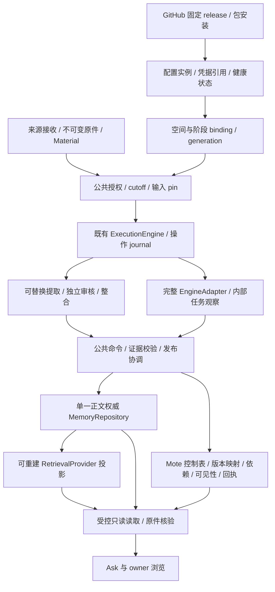

# 插件中心与可替换 Memory：一期实施方案

日期：2026-10-12。状态：**产品决策已接受；一期实现已接入，验证按层次记录**。

所有者已确认 1A–8A，并在设计原型之后授权实际实施、完整链路验收以及 PR/合并。本文保留决策与实施分解；当前支持的接口、固定适配器和运行限制见[插件中心](../plugin-center.md)，实际结果见[验证账本](plugin-center-phase-one-validation-2026-10-12.md)。最初只读设计基线为 `9aecdb1`，不能将该历史基线或合成原型当作当前产品验证。

需要模型时使用本地 Codex Server 的 `gpt-6.1-sol` / `medium`。本次实际验收使用独立 Central、生成原件与私有测试凭据；未读取或改写生产 Central，未采集个人截图。实现与可公开的生成回归测试可以随已授权 PR 提交；令牌、私有运行资料和模型输入留在本地。本文件不把供应方声明或 fixture 成功当作真实模型质量证明。

## 1. 已接受的产品选择

| 决定 | 一期范围 | 用户可见的含义 |
| --- | --- | --- |
| 1A：同时支持模块替换与整体引擎替换 | 模块模式组合提取、审核、整合、存储、检索；引擎模式声明接管的阶段 | 既能保留 Mote 流程换一个模块，也能选择一套完整 Memory 方案 |
| 2A：首批 Mem0 OSS 与 Hindsight | Mem0 OSS 验证 CRUD/检索模块模式；Hindsight 验证完整引擎模式 | 不把 Mem0 托管平台功能当作 OSS 已有能力；两者均需证明实际行为 |
| 3A：允许全部暂停自动 Memory | 暂停不删除归档、已发布 Memory 或索引 | 新资料继续归档和问答；自动记忆不再为新输入建立授权 |
| 4A：停止新任务，已有任务排空，另提供立即停止 | 已授权 queued/running/checkpointed 工作按固定旧 generation 完成；立即停止撤权并取消 | 普通暂停显示待完成任务；需要立刻终止时有单独操作 |
| 5A：受信插件，Central worker/service，必要时重启 | 首期 GitHub 可信 release 安装；声明依赖、进程与服务；不承诺沙箱 | 安装界面说明实际访问范围和重启影响；worker 只是运行边界，不是安全隔离保证 |
| 6A：先迁移和准备索引，成功再切换，失败保旧 | 迁移是显式操作；目标准备和核验成功后原子切换 binding | 准备期间旧方案继续服务；失败能查看原因、重试或退出 |
| 7A：设置 → 插件 | 在现有设置/系统管理中组织发现、已安装、方案和运行状态 | 不另建顶层市场入口；沿用当前导航与资料展示 |
| 8A：简单整体方案 + 高级模块组合 | 默认呈现当前方案、状态、切换；高级页面查看模块与依赖 | 普通用户不必理解 registry；高级用户能独立替换模块 |

一期保留独立审核环节，其实现与策略可以替换。完整引擎模式也必须满足独立审核与公共证据合同，不能以支持另一套引擎为由整体降低语义要求。本文不新增每日预算、调用次数、保留期限、输入规模上限或语义关键词规则；已有经确认的资源和输入合同按实际受影响流程处理。

「全部自动 Memory」包括自动提取、自动整合以及所选外部引擎的自动记忆写入任务。洞察/个人回顾、对话工作摘要等现有独立功能继续使用各自开关与授权，不因这次暂停顺带改变政策；`working-memory.ts` 的独立正文表也不在本次 repository 替换范围内。

## 2. 设计基线与改造起点（历史）

设计基线 `9aecdb1` 已有可替换提取/审核/整合策略和固定版本配方，复用 Cordis、MaterialStore、ExecutionEngine 与独立审核；正式资料可读，不等待 Memory。当时尚无可替换 MemoryRepository、RetrievalProvider、GitHub 包安装、统一配置实例或用户插件开关。下表说明改造起点，不再描述当前实现。

| 现有边界 | 实际代码与约束 | 一期需要改变的部分 |
| --- | --- | --- |
| Memory 策略 | `memory-strategies.ts` 分别注册提取、审核、整合与配方，固定版本/定义指纹 | 沿用能力注册，增加由配置实例和 binding 选择能力的路径 |
| Memory 正文与 CRUD | `memory.ts` 的 MemoryStore 同时做校验、写入、关系、纠正、删除、SQLite/FTS | 拆分公共命令/校验、正文 repository 和检索投影；调用方不能继续依赖具体 SQL |
| 证据读取 | `evidence-reader.ts` 直接创建 MemoryStore，直接查询 `memory_dependencies` | 注入受控服务，依赖查询走公共控制表/合同，Ask 仍只读 |
| 自动准入 | `memory-lifecycle.ts` 的 extraction.enabled 只接受 true；recipe selection 不允许空 | 新增独立 admission 状态和 generation；暂停不清除已保存组合，不借空数组表达停用 |
| 来源收据 | `memory-input-authorization.ts` 在原件接收事务保存授权或拒绝，重复 ACK 不续权 | 暂停期间保存拒绝收据；旧 generation 的原授权可排空，恢复只授权之后新输入 |
| 本地插件 | ConnectorRegistry 启动 import 本地受信模块；多个 env/path 入口 | 增加包来源/安装/实例/运行状态，再桥接已有 registries；不从正文安装代码 |
| 能力清单 | `feature-inventory.ts`、`/api/features`、FeatureInventory 展示运行能力 | 保留 inventory 作为事实核验；不能拿它代替包安装、期望状态与配置实例 |
| 展示 | WebFeatureHost 与 CentralCatalogDescriptor 有现成贡献和回退 | 新增插件控制平面和声明式配置 UI，验证 Web/Electron/Android 实际消费者 |

依据是 [当前架构](../architecture.md)、[Memory 策略](../memory-strategies.md)、[生命周期](../memory-lifecycle.md)、[社区扩展](../community-extensions.md) 和 [资料库插件契约](../library-plugin-contracts.md)。[后端重构工作稿](../backend-plugin-rearchitecture.md) 中的 QueryGateway/IndexProvider 是目标边界，不能当成已完成的检索供应方机制。

## 3. 三条完整用户旅程

### 旅程一：从 GitHub 安装，配置并启用

1. 用户打开「设置 → 插件」，看到当前整体 Memory 方案、自动处理状态和已安装列表，进入「发现」。推荐项也保留 GitHub 仓库、release、发布者和能力说明。
2. 用户输入 GitHub 仓库或 release 链接，宿主只解析元数据，展示确切版本、制品摘要、兼容宿主、依赖服务、访问范围、模型/远端数据流与是否需要重启。浏览 release 或解析 manifest 不执行插件代码。
3. 安装把固定 release 制品下载、核验并登记为包。它不创建默认运行实例、不自动接收新输入、不启动模型、不补跑历史。详情明确显示「已安装，尚未启用」。
4. 用户创建配置实例，选择本地 worker/service 或已有受信服务连接，填写声明式字段和凭据引用，执行连接/能力检查。凭据写安全存储，不进入 manifest、正文、支持包或源码。
5. 用户选择作用空间与整体/模块模式，检查将接管的阶段、保留的独立审核、同源多策略与数据流。已有依赖缺失时显示真实缺项；不会偷偷使用另一策略。
6. 启用配置实例不自动绑定记忆空间。已绑定实例的恢复建立新的准入代次，未绑定实例必须先完成方案准备和显式生效；恢复只为之后的新原件授予自动工作。需要重启的包显示真实待重启状态；一期两个内置适配配方由实际 worker/service 健康核验，按钮点击不等于能力核验成功。
7. 用户回到插件详情看到生效范围、当前版本、连接状态与运行任务。资料库/Memory/Ask 沿用原有入口，产物显示策略/供应方与证据。安装失败、配置错误、启动失败均有可重试状态，不改变旧方案。

### 旅程二：暂停全部自动 Memory，排空或立即停止，再恢复

1. 用户在整体方案页暂停自动 Memory。公共控制层在一个本地事务中关闭新准入并记录 cutoff；原有组合/配置实例保留。来源授权、采集开关与自动 Memory 暂停是不同控制。
2. cutoff 之前已经获得固定授权的 queued、running、checkpointed 工作仍绑定旧 generation、旧组件与旧输入。以暂停前登记的 operation/授权图为边界，已登记或已声明且属于其冻结范围的必要内部 child 可以继续，不能因暂停拒绝完成该操作所必需的审核或发布阶段，也不能扩张 scope 或无限自触发新的整合。它们可以继续排空、恢复并提交，但必须通过当前证据、隐私、删除、安装实例和原授权核验。尚未启动不等于未获授权；不能只让 running 排空而丢掉 queued 工作。
3. UI 显示「已暂停新任务，已有任务正在完成」及实际任务数/阶段。暂停期间的新资料继续接收、发布和问答，不建立新的自动 Memory 授权；归档成功不显示为 Memory 完成。
4. 用户若选择「立即停止」，宿主持久撤销本次被停用能力的未完成自动工作授权/发布权，记录取消并请求外部任务停止。显式手工任务继续按自己的原授权处理，只有用户明确选择一并停止时才取消。外部取消回执只证明请求接受时，显示真实的停止中或结果未知；晚到输出不得发布。不能承诺已发生模型费用被撤销。
5. 排空结束后显示「自动 Memory 已暂停」。再启用创建新 generation，从此后新接收输入建立新授权；暂停期间的拒绝收据不会因重启、重复 ACK、改配置或恢复而变成授权。
6. 需要处理漏过的资料时，用户在现有历史工作入口明确选择范围/方案并创建任务。该授权独立于自动恢复，不默认扫描全部历史。

这项「恢复不自动补历史」是对安装/恢复不续权原则的工程细化，不引入新的配额。暂停、移除 binding、卸载和隐私撤权必须分开：普通暂停允许排空；撤权或删除仍立即 fence；draining 期间插件 manager 不能 dispose 排空所需旧版本或阻断合法 commit，需先完成或明确停止其工作。卸载还要核验已有正文 reader 的可用性；正文权威在插件服务时，先迁移/保留受控 reader 才能卸载，不能让「保留历史」成为无法读取的承诺。

### 旅程三：切换 Memory 方案，迁移核验后生效，失败与回滚可解释

1. 用户在「Memory 方案」选择已配置目标，如从模块方案切换到 Hindsight。预览展示接管阶段、独立审核、依赖与迁移能力，明确这次是正文/引擎迁移还是只重建检索投影。
   从内置 repository 更换为 Mem0 CRUD，或从外部 repository 返回内置，同样是正文权威迁移，必须保留正文、版本、纠正与删除意图；只有 repository 不变、单独更换 RetrievalProvider 时才只准备索引。
2. 用户发起显式迁移。系统冻结一致 snapshot/水位与旧 binding，生成持久操作；安装本身没有迁移权。准备阶段旧方案继续读写，迁移靠变更日志追平；切换屏障前停止旧写者准入并排空/核对尾部。无法稳定追平时保留旧方案，不能漏掉边界新输入。
3. 目标有实际 export/import 能力才迁移正文/完整引擎。导入迁移全部 Mote 保留的记忆正文及更正/替代状态，保持 Mote ID、证据、规范修订、删除意图、关系与策略身份，不触发隐式模型重提取/整合。外部原生审计历史、额外旧版本和引擎图留在旧实例及运行备份中，不承诺跨引擎迁移。额外收费历史转换须已有明确授权；普通迁移不是无限历史重算许可。
4. 目标建立检索投影，逐项核验内容/依赖/范围、CRUD、查询引用及备份可恢复性。UI 显示「迁移中 → 索引准备 → 核验 → 切换」，阶段来自实际操作回执，不用定时进度伪装完成。
5. 核验成功后用 expected binding revision 原子发布新 generation。新请求读新绑定；已开始查询固定其 read binding。旧在途写任务只有在切换屏障前已接受的固定结果可归入迁移，不能切换后继续改旧库或写入新库。
6. 任一准备、导入、索引、核验或并发检查失败，保留旧方案可用，目标保持未发布并显示错误。重试复用幂等操作身份，不重复收费/重复导入。未知外部结果先核对，不盲重发。 取消准备释放临时屏障并保留所有者暂停选择、旧生效绑定及已授权的合法规范副本；不自动发布目标或清除迁移副本。来源精确删除/撤权仍使相应副本和操作正文失效并清除，未知外部写继续对账。
7. 回滚需要可恢复的完整 snapshot 和配置/供应方版本。新方案有新写入后，回滚也须迁移/核对变更与删除 tombstone，不能仅把指针切回旧备份。UI 先显示实际能力与影响；不支持无损回滚时如实说明，不能默默降级为仅处理新输入。

缺少 export/import、版本读取或删除保证的供应方仍可接入其已支持模块；不能假称完整引擎兼容。仅新输入替换、语义降级或其他替代路径不是一期默认 fallback，需要所有者单独选择。

## 4. 架构：公共控制与正文权威分离



### 4.1 四个能力面

| 能力面 | 拥有的职责 | 不得隐式取得的职责 |
| --- | --- | --- |
| MemoryPolicy | 提取、独立审核、整合和候选价值政策；固定版本配方 | 直接发布、扩大授权、替换公共证据校验或任务权威 |
| MemoryRepository | 版本化正文的唯一权威、规范 CRUD、受控导入导出 | 以删除正文代替删除完成回执；自行改变可见性或来源权限 |
| RetrievalProvider | 对正文/资料建立可重建 FTS、向量、图等投影，返回命中定位 | 成为另一套正式 Memory 正文权威；未经范围核验直接输出证据 |
| EngineAdapter | 声明 extract/integrate/retrieve/store 能力组合，观察自身内部任务与回执 | 以全功能标签绕过上述边界；把内部后台工作默认为获授权 |

模块模式可保留 Mote 提取与独立审核，替换 repository/retrieval。引擎模式明确停用被接管的内置提取/整合阶段，避免两套引擎双提取、双整合；独立审核和公共控制仍执行。同一记忆空间只有一个活动提交协调者，但允许个人、Coding 等策略对同一原件并行生成，各自保留配方身份与授权。

Mote 控制表保存 canonical ID、provider locator/revision、内容 hash、来源依赖、可见性、删除意图、操作状态与回执。一期明确保留 `memories.json`、reviewed output 与 exact put journal 的完整正文，用于比较、事务审查和恢复，尚不是 metadata-only SQL；外部 binding 的正式读取权威仍为 provider，不能静默用 SQL 正文回退。公共命令服务拥有用户操作语义、并发校验和发布协调；语义解释仍归模型/所选策略。原件与 Material 权威继续属于 Mote，记忆正文权威可以替换；index 不形成第二份可独立编辑的记忆。

### 4.2 包、配置实例与 binding 分离

下表保留设计职责。实际 JSON 字段与可用动作以 `packages/shared/src/plugin-center.ts` 和当前 [API](../plugin-center.md#api) 为准，不把概念状态当作客户端枚举：

| 对象 | 身份与状态 | 生命周期 |
| --- | --- | --- |
| PluginPackage / Release | publisher/repo、release tag、commit、asset digest、manifest schema、host capabilities、依赖、运行入口 | discovered → verified → installed；固定制品，不跟随 branch/main 漂移 |
| PluginInstance | package release、instance ID、配置 revision、secret refs、worker/service locator、installation epoch、desired/observed 状态 | configured → checking → ready / blocked / failed / restart-required；同一包可有多个明确实例 |
| MemoryBinding | space ID、mode、阶段能力 refs、instance IDs、scope、binding revision、generation、准入与排空状态 | draft → preparing → validated → active → draining / paused / retired；一次原子变更 |
| ProviderOperation | operation ID、idempotency key、input pin、expected revision、generation/fence、外部任务/回执、检查点 | intent → submitted → outcome-unknown / acknowledged → verified → published / cancelled / failed |

运行 inventory 是 observed capabilities，安装记录和 desired activation 是控制状态；三者有一致性投影但不相互替代。配置变更与卸载不能因同 ID/version 重装继承旧 installationEpoch 的提交权。密钥与正文不放包清单；能力请求属于受信部署声明，捕获内容和模型输出不能改变它。

### 4.3 跨库写入与发布

实现通过持久意图、外部不可变版本和宿主发布事务协调；调用外部服务不构成跨库原子提交。路径：

```text
本地持久 intent（输入/授权/generation/expectedRevision）
  → 外部幂等写入或 staging 任务
  → external receipt（accepted / running / completed，携带可核对 revision）
  → 读回结果与独立审核、当前范围/证据/删除/fence 核验
  → 本地事务发布 binding / accepted revision / 操作结果
  → 派生检索投影与用户状态刷新
```

用现有执行器及操作 journal 配合 outbox/inbox/reconciliation，处理外部成功本地未记录、提交后断线、重复回调、取消竞态与旧 worker 晚到。外部 accepted 不等于 Memory published；网络结果未知时先查询 operation status 或按 idempotency key 核对，再决定重试。跨组件状态由 ExecutionEngine 恢复；供应方内部任务不是第二套 Mote 用户操作权威。

外部正文在宿主核验前必须有 staging 隔离，或有可以固定读取且不会被未接受结果污染的不可变 revision/snapshot。Ask 只读已发布版本。仅在控制表标记 hidden，而检索或 reflect 仍读取外部 current，无法阻止晚到产物参与答案。适配器必须实测这一条件；不满足时不能交付完整引擎模式。

### 4.4 scope、自治任务与 Ask

配置实例声明本地/远端数据路径、模型连接、内部自动提取/整合/反思/过期/清理任务，以及这些任务能否关闭、取消、固定版本、观察进度和用量。每个任务继承可核验输入范围与获授权操作，不能通过 service 自治绕过暂停、来源撤权或历史授权。停止 Mote 提交新输入不等于外部引擎停止自治工作；必须真实控制其触发/schedule/worker，并准确观察停止过程，无法控制时不能标为已停用。可信 worker/service 不是沙箱；一期只运行受信 release，仍执行宿主作用域与凭据隔离。

查询工具继续只读。retrieve 返回候选定位、scope/provenance 与 provider revision，经 Mote 回读、当前授权及原件范围核验后使用。reflect 是查询时生成的派生解释，不是原始证据，也不能自动写回。若供应方 reflect 隐含写入，适配器关闭该路径或另作明确授权的后台操作；不能藏在 Ask 读取中。

图关系、多卡片综合与摘要需要完整支持依赖，不能只引用终点卡片。只有本轮实际交付且范围允许的原始片段进入引用账本；供应方给出的答案/来源名称不自动获得引用资格。跨来源/设备/时间范围、第三方归属、原文修订与删除仍按现有严格证据合同执行。

外部 tag 过滤不能未经验证就等同于 Mote 授权隔离。需验证 bank/namespace、无标签内容、directive、派生 observation/mental model 的实际召回范围；可信引擎配置指令与捕获正文严格分开，正文不能生成 global directive 或新的工具权限。

### 4.5 删除、备份与切换一致性

- Memory 删除保存用户意图和防重建 tombstone；原始资料删除沿依赖撤销产物，二者区分。外部正文、图、向量、缓存与内部任务的删除回执区分 accepted、pending、verified-erased、failed/outcome-unknown。UI 可显示「已禁止使用，外部删除仍在完成」；不能在只收到 accepted 时显示全部删除完成。
- 版本读取须支持规范 ID、provider locator 和实际内容 hash 核验。不能读取旧字节的供应方需要适配器提供版本隔离能力，不能靠一个可变 provider ID 假装 revision。
- 备份包含一致 snapshot/水位、正文权威、canonical 映射、依赖、纠正与删除意图、配置/供应方 release、binding/generation、执行/外部操作恢复信息。索引可省略备份的前提是实际可重建并经核验；凭据/私钥另行保管。
- 恢复须匹配 provider/adapter 合同并验证当前删除 tombstone，不能让旧备份复活已删内容。远端服务无法固定内部版本时要如实报告恢复限制。
- 切换屏障需核对旧任务与变更尾部。已有查询固定 read binding；旧写者 generation 退役后不得继续提交。索引准备成功不能掩盖正文、引用或删除迁移失败。

## 5. 已接入 API 与合同

控制操作仅限现有 owner 授权。collector/MCP read/query agent 无权安装、改配置或切换方案。请求固定 `operationId` 和 `expectedRevision`，丢响应重放同一意图；显式失败重试创建新的操作意图。实例命令核验实例 revision，安装/卸载核验中心 revision，记忆控制核验 binding view revision。

| API | 作用与结果 |
| --- | --- |
| `GET /api/plugins`、`POST /api/plugins/resolve` | 包/实例事实与目录；解析固定 GitHub release，返回私有已固定预览身份 |
| `POST /api/plugins/install`、`POST /api/plugins/:id/uninstall` | 安装已核验预览；有活动绑定、固定 reader 或待对账外部写/清除时禁止卸载 |
| `POST /api/plugin-instances`、`PATCH /api/plugin-instances/:id` | 创建/修改声明式配置实例；凭据只用已存在的模型配置引用 |
| `POST /api/plugin-instances/:id/check`、`.../enable`、`.../disable` | 实际核验、期望启停；启用不自动绑定，停用不删除正文 |
| `GET /api/memory-spaces/default/binding` | 当前整体/高级阶段、代次、准入/排空、候选方案和准备状态 |
| `POST /api/memory-spaces/default/binding/prepare` | 用户确认范围与费用后迁移保留正文/状态，准备投影，冻结并核对尾部 |
| `POST /api/memory-spaces/default/binding/activate`、`.../retry`、`.../cancel` | 核验后显式生效；失败保旧；取消不自动切换 |
| `POST /api/memory-spaces/default/binding/pause`、`.../resume`、`.../stop` | 全自动 Memory 准入控制、旧授权排空与独立立即停止；恢复不补历史 |
| 现有 `/api/memory-jobs` | 显式范围/配方的历史工作，不因安装或恢复自动调用 |

当前方案选择支持内置、Mem0 repository+retrieval 组合和受控 Hindsight 完整引擎。高级页面查看实际模块/绑定；同正文权威的单独 retrieval 更换、任意新模块组合编辑未实现。合同中的 index-only 分类为扩展边界，不能据此宣称当前已有独立索引替换旅程。

一期未新增任意空间控制、单独 `GET /api/plugins/:id` 或指针式 `/rollback`。反向切换沿同一正文迁移/核验流程完成。统一 owner DTO 在 `packages/shared/src/plugin-center.ts`；实际 provider/engine 合同在 `memory-provider-contract.ts`、`memory-adapters.ts` 与固定适配器中。

通用兼容 release 支持 repository/retrieval ABI；完整 engine 要经过宿主控制适配与真实能力核验，不能只凭 manifest 宣称 engine ready。配置 schema 为无代码数据。普通上游仓库没有适配 manifest 时不可安装；固定 Mem0/Hindsight 官方发布例外由当前 Mote 构建内的受控适配配方提供，详见[当前支持范围](../plugin-center.md)。

## 6. UI 信息架构与多宿主消费者

最接近的现有模式是系统管理的「扩展能力」与「模型与服务」、统一 Operations 和资料库贡献。插件中心在「设置 → 插件」组织这些相关管理操作；入口调整不以 backend module 个数决定导航。历史原型仅演示合成状态。当前 Web/Electron renderer 和原生 Android 已接入真实 owner API；原型结果与产品验证分开记录。

| 页面/组件 | 主要交互 | 必须展示的真实状态 |
| --- | --- | --- |
| 插件概览 | 当前 Memory 方案、暂停/恢复、正在完成工作、进入发现 | 当前 binding 与新任务开关；已装不等于已启用 |
| 发现 / 从 GitHub 添加 | 推荐项、仓库/release 输入、版本详情、安装 | 确切来源/版本、兼容性、依赖/数据流、安装或重启进度 |
| 已安装 / 插件详情 | 配置实例、连接检查、作用范围、启停、版本/错误 | desired/observed 差异、不可用原因、依赖与历史保留 |
| Memory 方案 | 当前整体方案、选择目标、准备/核验/切换 | 旧方案服务中、迁移/index 阶段、失败保旧、切换结果 |
| 高级模块组合 | 查看实际阶段、策略/repository/retrieval 与固定绑定；现有策略设置管理已支持配方 | 同源多策略、独立审核、单提交协调者、固定版本/配置 |
| 任务与历史 | 排空、立即停止、错误重试、显式历史工作 | accepted/published、取消与外部结果未知、删除 pending |

动态包只提供宿主已支持的声明式字段、状态、依赖和动作 descriptor，不能注入任意远程 React/HTML/URL 脚本。受信编译期 Web 贡献继续沿 FeatureManifest/WebFeatureHost，依赖与卸载回退继续核验；新原生采集能力仍需原生构建。

Web/Electron 需通过实际 renderer 证明导航、安装配置表单、重启后恢复、scope 变更与停用后历史可读。Android 需有实际原生消费者：显示当前方案/状态、通用配置与任务动作，声明式未知字段/贡献使用明确的受支持回退；不能只有 CentralCatalogDescriptor 的字段定义而没有屏幕使用。新 UI 文案使用 moteText，并同步 TypeScript 和 Android English catalog。

## 7. 实际代码改造位置

| 位置 | 拟议改变 | 消费者/回归关注 |
| --- | --- | --- |
| `apps/server/src/memory.ts`、`memory-deletions.ts`、`memory-schema.ts` | 分出公共命令/证据校验、控制元数据与 repository；保留纠正/关系/删除意图 | Pipeline、Integration、Routes、Reader、导出/恢复不能继续直写旧表 |
| `evidence-reader.ts`、`context-query.ts`、`context-index.ts`、`memory-routes.ts` | provider 版本读取与依赖接口注入，去掉 Memory 物理 SQL/具体 MemoryStore 依赖 | owner 列表/详情/下载、Ask、scope、引用 ledger |
| `conversation-understanding.ts`、`semantic-extraction.ts` | 改走公共候选校验/受控读取，不能保留隐蔽的旧 MemoryStore 路径 | Coding 候选复用、理解产物、自动/手工提取与独立审核一致性 |
| `memory-pipeline.ts`、`memory-integration.ts`、`memory-review.ts`、`memory-strategies.ts` | 阶段绑定与完整引擎接管、独立审核、已获授权旧 generation 排空 | 同源多策略、草稿复用、取消/恢复/晚到提交 |
| `memory-lifecycle.ts`、`memory-recipe-settings.ts`、`memory-input-authorization.ts`、`material-memory-work.ts`、`capture-memory-intake.ts`、`source-pipelines.ts` | 新准入状态/cutoff/generation；暂停拒绝新收据；恢复不续权 | 普通来源、Coding archive、截图/页面、导入真实接收顺序 |
| `app.ts`、`backend-plugin-scope.ts`、`connectors/registry.ts`、`config.ts` | 包管理/实例所有者与已有 Cordis/服务桥；启动恢复与资源释放 | restart-required、dependency install、失败保旧、installationEpoch |
| `execution-engine.ts`、`operations.ts`、`feature-inventory.ts` | 跨库操作回执/reconciliation 和准确状态投影 | 外部结果未知、排空/立即停止、Inventory 与期望不一致；`working-memory.ts` 独立开关/表保留 |
| `packages/shared/src/feature-packs.ts` 与新增合同模块 | package/instance/binding/能力/声明式 UI schema | server、Web、Electron、Android 实际解析与版本不一致 |
| `apps/web/src/features/features.tsx`、`FeatureInventory.tsx`、`features/models.tsx`、`ServerSettings.tsx`、`features/host.ts`、`navigation.ts` | 设置 → 插件及整体/高级页面，整合既有能力清单与设置入口 | 返回路径、依赖错误、历史正文通用回退、双语 |
| `apps/desktop/src/navigation.ts` 与实际 renderer host；Android CentralCatalogDescriptor/设置/资料浏览 | 平台可用的声明式配置/状态/动作与导航 | 不能只验证 Web 或 schema；真机行为单独报告 |
| `scripts/backup.ts`、`material-portable.ts` 与现有 portable/archive 消费入口 | provider snapshot、水位、映射、删除与恢复合同 | 当前便携归档格式与完整运行备份分开，不直接宣称旧格式承载新引擎 |

已实现模块位于 `plugin-release.ts`、`plugin-center.ts`、`memory-automation.ts`、`memory-bindings.ts`、`memory-publication.ts`、`memory-adapters.ts`、固定 Mem0 worker 与 Hindsight runtime/engine。Web `PluginCenter.tsx` 和 Android `CentralPlugins.kt` 是实际消费者。上述责任分解不代表任意新 provider 已兼容；每个实例仍须实际核验。

## 8. 实施 waves、依赖与交付门槛

| Wave | 交付 | 依赖与完成门槛 |
| --- | --- | --- |
| W0：合同与可行性 | 规范命令/repository/retrieval/engine 能力矩阵、generation/回执/删除/引用合同；固定 Mem0 OSS 与 Hindsight 可运行版本 | 验证供应方实际 staging/version/provenance/delete 与 autonomous-task 控制；不能以 README 标签宣布完整兼容 |
| W1：公共控制与默认实现 | 将现 SQLite 拆为默认 repository/projection，所有实际消费者走接口；实现暂停/排空/停止/恢复语义 | 保持当前 fixture journey 与语义质量合同；去掉消费者直接 SQL，旧工作按旧授权和 generation 恢复 |
| W2：受信包与多宿主控制面 | GitHub release 安装、实例/secret refs、依赖与重启、声明式配置 UI；设置 → 插件 | W0 合同；真实启动/关闭/重启和实际 Web/Electron/Android 消费路径，安装不触发模型/历史扫描 |
| W3：Mem0 OSS 模块模式 | 真实 CRUD、检索、版本映射、纠正/删除、scope 与恢复；替换 repository 时迁移正文与索引 | W1；实际 Mem0 运行，所有 CRUD 消费者走所选正文权威；正文/版本/纠正/删除意图迁移与核验通过，不以只换索引、mock SDK 或手工组装路径代替 |
| W4：Hindsight 引擎模式与切换 | 声明接管阶段、独立审核与受控可见性、真实 retain/recall/reflect 路径、迁移/index 核验后切换 | W1/W3 的规范合同；实际引擎验证，不双提取/整合、不在 query 隐写；失败保旧/回滚能力证明 |
| W5：完整产品验证与交付 | 三条旅程、跨库恢复、语义效果、备份/删除与消费者检查；更新当前文档/发布说明 | W2–W4；只将实际已实现行为更新为当前架构，按受影响组件及消费者运行规定检查 |

W2 的原型与部分控制 UI 可以并行设计，但不能在供应方可行性未成立时把“完整引擎可用”作为成品状态。阶段失败不以静默降级结束；未知能力要缩小已支持模式或带回 owner 决策。这些 waves 已进入实现与验证；表中门槛仍作为分层验收要求，实际执行结果见验证账本。未执行的组合或平台不能由其他层次的成功代替。

后续交付需通过 [验证方案](plugin-center-phase-one-validation-2026-10-12.md)：生成 fixture 覆盖结构/生命周期，实际依赖/worker/service 和 renderer 覆盖安装重启，Mem0 OSS CRUD/检索与 Hindsight 引擎模式覆盖真实行为，独立语义 rubric 覆盖质量。真实模型、真实 GitHub/服务账户与物理设备检查分别记录；没有实际执行不能写 passed。实际实现验收运行 `npm run check:affected` 覆盖受影响组件及消费者，并补充生成故障旅程、实际服务/模型与 UI 证据。所有者已授权验收后的 PR 和合并；本地私有凭据、生产资料与临时报告不随代码提交。

## 9. Supersession 与未知

本 ADR 接受目标行为，当前支持实现见插件中心文档。下表记录旧职责的保留和替换范围；历史 ADR 保留原决定，并链接本次 supersession。

| 类别 | 保留/变化/退出与需检查位置 |
| --- | --- |
| KEEP | AI-native 模型语义解释；原件/Material、精确证据、只读 Ask、独立审核、单一 ExecutionEngine、日志隐私、版本/取消/删除/用量公共保证；检查 AGENTS、agent prompts、read tools、validation 合同 |
| KEEP | 取消迁移不等于删除数据：已授权规范副本保留、目标不生效；精确来源删除/撤权仍清除依赖副本、操作正文与未知晚到写 |
| KEEP | 同源个人/Coding 多策略、固定组件与输入、有效草稿复用、来源授权/暂停、安装不授权历史、可读原文不等待 Memory；检查策略、source intake、Material、导入与理解任务 |
| CHANGE | 现有「获授权新输入必须持续提取」改为 owner 可全暂停；`extraction.enabled:false` 拒绝与非空配方不可停用不再决定自动准入，增加显式 pause/generation；检查 `adr-material-attribution`、`adr-mvp-baseline`、生命周期/策略文档及相关 API/UI/test |
| CHANGE | 选择/binding 变化区分普通暂停排空与撤权立即 fence；既有 queued/running/checkpointed 及授权图内必要 child 依固定旧 generation 排空，恢复不补历史；检查 `revokeDisabled`、配置 callbacks、启动 resumer、pending grants、external jobs；不要沿用「当前 selection 不含就一律撤销」到普通 pause |
| CHANGE | 本地 env/path 模块加载发展为 GitHub 固定 release 包 + 配置实例 + bindings；Inventory 成为观察投影而非安装状态权威；检查启动/关闭、FeatureManifest、registry、依赖、配置/凭据与 UI |
| CHANGE | Memory 正文可由 repository/engine 替换；控制权与正文权威分离；检查每个 reader、writer、搜索、导出/恢复/GC、备份、SQL trigger 与删除链路 |
| REMOVE | 消费者直接依赖 MemoryStore/物理 memory SQL；用安装=启用、停用=删除、空 recipes=暂停、外部 accepted=完成、current inventory=包管理的表达；完整引擎接管阶段的重复内置提取/整合 |
| EXCEPTION | 一期保留完整宿主 control/review/journal 正文用于审查与恢复；外部绑定正式读回 provider，不能以 SQL 副本掩盖缺失或篡改 |
| EXCEPTION | 隐私/来源撤权、原件删除、显式立即停止、无效证据继续立即阻止发布；普通暂停不授予旧任务突破这些条件的特权；缺失旧组件工作真实 blocked，不换版本完成 |
| EXCEPTION | 新 source/UI/plugin 包只扩展已支持合同；原生采集需构建；受信服务可要求重启，worker 非沙箱；已发布历史保留与通用回退，卸载/删除/重算分开；洞察和工作摘要不顺带停用，显式手工任务不被自动停止命令隐式取消 |
| CHANGE | 固定 Mem0 不可变 literal 版本/journal、Hindsight 隔离 operation bank 与已授权 read-bank 已接入；实际 probe/模型/备份证据独立记录。跨引擎迁移只涵盖全部 Mote 保留正文/状态，不包括可移植的原生全部审计/图历史 |
| UNKNOWN | 私有 GitHub 仓库专用凭据、任意第三方完整 engine、物理擦除、跨引擎原生审计图迁移、多平台设备运行和完整语义质量/性能矩阵；未实测的服务/版本不继承固定适配器验证 |

暂停的旧 policy 取代范围包括 [Material 归属 ADR](../adr-material-attribution.md) 的持续处理决定及 [MVP 基线 ADR](../adr-mvp-baseline.md) 的 `extraction.enabled` 只接受 true；其他归属、epoch、原件与安全决定保留。[系统改造 ADR](../adr-system-refactor.md) 的独立审核、滚动包、只读工具和单执行器继续保留。[日常事件 ADR](../adr-daily-event-memory.md) 的默认组合和 scope 不因插件中心而自动扩张。

## 10. 外部依据与本次验证状态

2026-10-11 调研依据（后续实现必须固定并重新核对实际 release）：[Mem0 Platform vs OSS](https://docs.mem0.ai/platform/platform-vs-oss)、[Hindsight 官方仓库](https://github.com/vectorize-io/hindsight)、[Graphiti 官方仓库](https://github.com/getzep/graphiti)、[LangMem memory reference](https://langchain-ai.github.io/langmem/reference/memory/)、[DeepSeek Harness plugin manager](https://github.com/deepseek-ai/deepseek-harness/blob/master/packages/boot/plugin-manager/README.md)。它们支持能力研究和适配设计，不证明 Mote 已安装或满足本合同。

设计阶段的官方文档复核提出以下核验点；随后固定供应方的实际结果见验证账本，这些公开说明本身不是运行证据：

- [Hindsight operations](https://hindsight.vectorize.io/developer/api/operations) 的 running cancel 是协作式；已提交内容保留，当前批可能继续完成，无 checkpoint 的工作可能继续到结束。`cancelled` 状态不能单独证明停止写入；需发布屏障与实际操作/数据观察。
- Hindsight 自动工作包括 consolidation、mental model refresh、graph maintenance 与 webhook delivery。全暂停需分类核验写入、费用与触发关系；[services](https://hindsight.vectorize.io/developer/services) 的 API/worker 分离配置可供实验，但不等于自动任务全部禁用。
- [Retain safe retries](https://hindsight.vectorize.io/developer/api/retain#safe-retries-with-operation_id) 提供客户端 operation_id，可用于丢 ACK 的幂等恢复；async retain 不返回 usage metrics，计量须另找实际可观测路径，未知不能记零。
- [Recall](https://hindsight.vectorize.io/developer/api/recall) 的 tag 模式、无标签内容与 [reflect](https://hindsight.vectorize.io/developer/api/reflect) 的 directives/派生层需要范围实测；公开 reflect 合同不能证明固定 snapshot 或无写回。
- [Hindsight installation](https://hindsight.vectorize.io/developer/installation) 的 PostgreSQL/向量扩展、worker、embedding/reranker 是安装依赖与运维路径的一部分；开发便利配置不能当作已验证的生产部署方案。
- [Mem0 OSS 区别](https://docs.mem0.ai/platform/platform-vs-oss) 限定本次使用开源实现；TypeScript 默认内存 vector store 需要替换为实际持久存储，不能据此交付跨重启 CRUD；托管 graph/temporal/dream 不作为 OSS 验收承诺。

Graphiti/LangMem 是后续适配参照，不加入一期必交付范围。Harness 插件发现/生命周期可复用其适合的部分，但不能将 Agent 插件管理直接当成 Mote 的正文权威、历史授权、供应方迁移或 UI 控制平面。

历史设计阶段完成仓库只读调查、方案、ADR 和合成 UI 浏览器检查，见[第 11 节](plugin-center-phase-one-validation-2026-10-12.md#11-历史设计原型检查)。后续真实实现、生成 fixture、固定供应方/模型、实际产品 Web UI 和备份结果按独立层次记录。物理设备、未运行平台及完整质量矩阵仍为 NOT RUN；不读取或传输个人截图。
