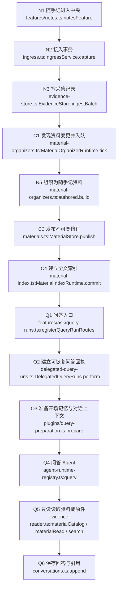
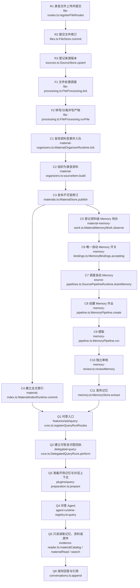
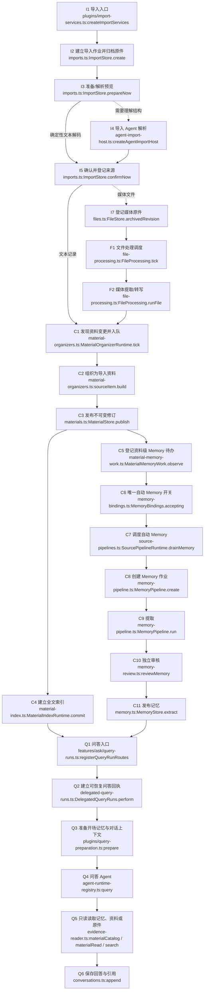

# 一条资料的一生

本文只写资料**进入中央之后**发生的事：随手记、一段录音、一份导入分别经过哪些模块、哪些模型，最后怎样被问答读到。端侧采集、隐私规则和上传队列不在图内，见[采集与同步](collection-and-sync.md)和[文件归档](files.md)。

图里的每个编号在下方表格中都有同一行的 `模块文件` 与 `函数`；`git grep -n "<函数名>" -- <模块文件>` 应能找到对应实现。图中标签为了可读性省略了 `apps/server/src/` 前缀，完整路径以表格为准。模型列区分“语言 Agent”“本地模型/服务”和“不调用模型”；写表列只列主要业务表，FTS、目录和证据依赖等由同一事务或触发器维护的派生表紧随主表。

三条路径的简要结论：

| 入口 | 中央主要动作 | 会遇到的模型/Agent | 最后怎样被问答用到 |
|---|---|---|---|
| 随手记 | 接收 → 采集记录 → 正式资料 → 全文索引 | 问答时才调用问答 Agent；可选 embedding | `material_catalog` / `material_read`，或直接 `search_context` |
| 一段录音 | 文件提交 → 来源版本 → 转写/分离 → 正式资料 → 自动 Memory → 索引 | 本地 ASR/分离模型；可选摘要/语义模型；Memory 提取与独立审核 Agent；问答 Agent | 已发布记忆和/或正式资料、原件 |
| 一份导入 | 导入作业 → 解析预览 → 确认登记来源 → 正式资料 → 自动 Memory → 索引 | 导入 Agent（仅非确定性解析）；媒体处理模型；Memory Agent；问答 Agent | 已发布记忆和/或正式资料、原件 |

三条路径都可能另走可选向量索引：`Indexer.run` 为采集记录写 `captures.embedding`，为文件片段写 `file_chunks.embedding`；`EvidenceReader.search` 在配置 embedding 时使用它。它不改变正式资料或记忆的身份，图中省略。

## 1. 随手记

进入中央后，随手记只做四件事：**收下、组织成一份正式资料、建全文索引、等待问答读取**。它不自动创建 Memory；原因见本节末尾。



| 节点 | 这一步 | 模块文件 | 函数 | 调用模型 | 写表 |
|---|---|---|---|---|---|
| N1 | 校验随手记并取得提交授权 | `apps/server/src/features/notes.ts` | `notesFeature` | 否 | — |
| N2 | 进入统一接入事务 | `apps/server/src/ingress.ts` | `capture` | 否 | — |
| N3 | 校验、去重并提交采集记录 | `apps/server/src/evidence-store.ts` | `ingestBatch` | 否 | `captures`、`captures_fts`、`changes`、`devices`；有图片时另写 `blobs`；有资料说明时另写 `record_context_declarations`；所有采集另写后台模型授权回执 `background_model_receipts` |
| C1 | 发现采集变更，建立组织任务 | `apps/server/src/material-organizers.ts` | `tick` | 否 | `material_organizer_inputs`、`material_organizer_groups`、`material_organizer_digests`、`execution_steps` |
| N5 | 把随手记组织成 `mote.note` 资料草稿 | `apps/server/src/material-organizers.ts` | `build` | 否 | —（只读采集记录） |
| C3 | 发布稳定 ID、不可变修订和内容块 | `apps/server/src/materials.ts` | `publish` | 否 | `material_heads`、`material_revisions`、`material_blocks`、`material_block_payloads`、`material_members`、`material_evidence`、`material_evidence_context`、`material_evidence_dependencies`、`material_index_requests` |
| C4 | 建立正式资料全文索引 | `apps/server/src/material-index.ts` | `commit` | 否 | `material_fts`、`material_searchable`、`material_index_requests` |
| Q1 | 接收 `/api/query` | `apps/server/src/features/ask/query-runs.ts` | `registerQueryRunRoutes` | 否 | — |
| Q2 | 建立可恢复问答回执并启动持久委派 | `apps/server/src/delegated-query-runs.ts` | `perform` | 否 | `query_runs`、`delegation_works`、`delegation_payloads`、`execution_steps` |
| Q3 | 准备开场记忆、历史对话和本轮固定范围 | `apps/server/src/plugins/query-preparation.ts` | `prepare` | 否（新问题）；跟进对话做工作记忆压缩时会调用模型 | `delegation_payloads`（准备好的输入）、`delegation_dependencies`（本轮证据依赖）；跟进对话可能写 `working_memories` |
| Q4 | 运行只读研究 Agent | `apps/server/src/agent-runtime-registry.ts` | `query` | 是（问答语言模型） | `model_usage`（用量）；模型产物不直接落资料表 |
| Q5 | 按问题选择正式资料、原件检索或时间线 | `apps/server/src/evidence-reader.ts` | `materialCatalog`、`materialRead`、`search` | 否；配置 embedding 时 `search` 会调用 embedding 模型 | —（只读 `material_*`、`captures`、`file_chunks`） |
| Q6 | 保存回答、引用和本轮范围 | `apps/server/src/conversations.ts` | `append` | 否 | `conversations`、`conversation_turns` |

**为什么随手记没有自动 Memory。** 在这三条路径里，自动 Memory 的新输入授权来自两处：来源条目在 `SourceStore.upsert` 中调用 `memoryInputs.receive`，图片/页面在 `installCaptureMemoryIntake` 中调用 `work.inputs.receive`。`POST /api/notes` 走的是 `IngressService.capture` → `EvidenceStore.ingestBatch`，不经过这两个入口，因此这份随手记本身只发布正式资料和索引，不创建 `material_memory_requests`。`background_model_receipts` 只是后台模型授权回执，不是 Memory 输入授权；问答仍可直接检索和读取这份资料。

## 2. 一段录音

这里的录音指设备上传的音频文件（例如 Android 录音目录或 macOS 文件同步），不是连接器已经自带厂商转写的录音。进入中央后，中央做六件事：**收原件、登记来源版本、转写/分离、组织正式资料、自动 Memory、建索引**。文件产物就绪会再次触发 `changes`；组织器可能先发布 `pending` 修订，转写完成后发布新修订，图中按最终发布画。连接器自带完整转写时走 `Files.transcriptRevision`，直接写 `file_artifacts` 和 `file_chunks`，跳过本地 ASR，之后同样进入资料组织与 Memory。



| 节点 | 这一步 | 模块文件 | 函数 | 调用模型 | 写表 |
|---|---|---|---|---|---|
| R1 | 音频分片上传与提交入口 | `apps/server/src/file-routes.ts` | `registerFileRoutes` | 否 | — |
| R2 | 校验分片、保存内容寻址原件并提交修订 | `apps/server/src/files.ts` | `commit` | 否 | `file_uploads`、`file_parts`、`file_objects`、`file_versions`、`file_heads`、`file_jobs` |
| R3 | 登记来源、不可变版本和当前指针 | `apps/server/src/sources.ts` | `upsert` | 否 | `captures`、`source_versions`、`source_heads`、`memory_input_authorizations`、`changes` |
| F1 | 发现待处理文件并交给执行器 | `apps/server/src/file-processing.ts` | `tick` | 否 | `execution_steps`（排队与租约） |
| F2 | 本地转写、说话人分离、对齐；可选摘要/语义分组 | `apps/server/src/file-processing.ts` | `runFile` | 是（本地 ASR/分离模型；可选语言模型做摘要或语义分组） | `file_jobs`、`file_steps`、`file_artifacts`、`file_chunks`、`model_usage` |
| C1 | 发现文件产物变更，建立组织任务 | `apps/server/src/material-organizers.ts` | `tick` | 否 | `material_organizer_inputs`、`material_organizer_groups`、`material_organizer_digests`、`execution_steps` |
| C2 | 把音频的转写片段组织成正式资料草稿 | `apps/server/src/material-organizers.ts` | `build` | 否 | —（只读原件和文件产物） |
| C3 | 发布正式资料修订 | `apps/server/src/materials.ts` | `publish` | 否 | `material_heads`、`material_revisions`、`material_blocks`、`material_block_payloads`、`material_members`、`material_evidence`、`material_evidence_context`、`material_evidence_dependencies`、`material_index_requests` |
| C4 | 建立正式资料全文索引 | `apps/server/src/material-index.ts` | `commit` | 否 | `material_fts`、`material_searchable`、`material_index_requests` |
| C5 | 把资料修订登记为自动 Memory 待办 | `apps/server/src/material-memory-work.ts` | `observe` | 否 | `material_memory_requests`（授权已在 R3 写入 `memory_input_authorizations`） |
| C6 | 检查唯一的自动 Memory 总开关 | `apps/server/src/memory-bindings.ts` | `accepting` | 否 | `memory_automation`（读；`MemoryAutomation.command` 暂停/继续时才写） |
| C7 | 领取授权并调度 Memory 作业 | `apps/server/src/source-pipelines.ts` | `drainMemory` | 否 | `material_memory_requests`（`job_id`）、`memory_input_authorizations`（claim） |
| C8 | 创建 Memory 作业和批次 | `apps/server/src/memory-pipeline.ts` | `create` | 否 | `memory_jobs`、`memory_batches` |
| C9 | 按授权范围提取候选记忆 | `apps/server/src/memory-pipeline.ts` | `run` | 是（Memory 提取模型） | `memory_batches`、`memory_checkpoints`、`memory_publications`、`model_usage` |
| C10 | 独立只读审核候选、证据和覆盖范围 | `apps/server/src/memory-review.ts` | `reviewMemory` | 是（独立 Memory 审核模型） | —（只返回评审回执，随发布进入 `memories`） |
| C11 | 校验并发布记忆，维护目录与证据依赖 | `apps/server/src/memory.ts` | `extract` | 否（模型调用在前两步） | `memories`、`memories_fts`、`memory_catalog`、`memory_scopes`、`memory_dependencies`、`memory_publications` |
| Q1 | 接收 `/api/query` | `apps/server/src/features/ask/query-runs.ts` | `registerQueryRunRoutes` | 否 | — |
| Q2 | 建立可恢复问答回执并启动持久委派 | `apps/server/src/delegated-query-runs.ts` | `perform` | 否 | `query_runs`、`delegation_works`、`delegation_payloads`、`execution_steps` |
| Q3 | 准备开场记忆、历史对话和本轮固定范围 | `apps/server/src/plugins/query-preparation.ts` | `prepare` | 否（新问题）；跟进对话做工作记忆压缩时会调用模型 | `delegation_payloads`（准备好的输入）、`delegation_dependencies`（本轮证据依赖）；跟进对话可能写 `working_memories` |
| Q4 | 运行只读研究 Agent | `apps/server/src/agent-runtime-registry.ts` | `query` | 是（问答语言模型） | `model_usage`（用量）；模型产物不直接落资料表 |
| Q5 | 按问题选择记忆、正式资料、原件检索或时间线 | `apps/server/src/evidence-reader.ts` | `materialCatalog`、`materialRead`、`search` | 否；配置 embedding 时 `search` 会调用 embedding 模型 | —（只读 `memories`、`material_*`、`captures`、`file_chunks`） |
| Q6 | 保存回答、引用和本轮范围 | `apps/server/src/conversations.ts` | `append` | 否 | `conversations`、`conversation_turns` |

## 3. 一份导入

导入是“先归档原件，再解析预览，确认后才登记来源”的独立运行时。进入中央后，中央做六件事：**收原件、解析/预览、确认登记来源、处理媒体、组织正式资料、自动 Memory 与索引**。



| 节点 | 这一步 | 模块文件 | 函数 | 调用模型 | 写表 |
|---|---|---|---|---|---|
| I1 | 导入命令入口 | `apps/server/src/plugins/import-services.ts` | `createImportServices` | 否 | — |
| I2 | 建立导入作业、保存输入原件 | `apps/server/src/imports.ts` | `create` | 否 | `import_jobs`、`import_create_requests`、`archived_files`、`file_blobs` |
| I3 | 选择解析路径并生成预览 | `apps/server/src/imports.ts` | `prepareNow` | 条件：普通文本走 `preparePlain` 不调用；需要理解结构时走导入 Agent | `import_jobs`（状态、预览、处置清单） |
| I4 | 模型读取归档副本并生成受宿主校验的清单 | `apps/server/src/agent-import-host.ts` | `createAgentImportHost` | 是（导入 Agent） | —（只写私有工作区，不直接写资料库） |
| I5 | 校验清单、确认导入并登记来源 | `apps/server/src/imports.ts` | `confirmNow` | 否 | `source_connections`、`captures`、`source_versions`、`source_heads`、`memory_input_authorizations`、`changes`、`import_jobs`、`capture_files` |
| I7 | 把导入中的媒体原件登记为文件修订 | `apps/server/src/files.ts` | `archivedRevision` | 否 | `file_objects`、`file_versions`、`file_heads`、`file_jobs` |
| F1 | 发现待处理媒体并交给执行器 | `apps/server/src/file-processing.ts` | `tick` | 否 | `execution_steps`（排队与租约） |
| F2 | 媒体提取、转写或图片文字识别 | `apps/server/src/file-processing.ts` | `runFile` | 是（本地 ASR/OCR/分离模型；可选语言模型做摘要或语义分组） | `file_jobs`、`file_steps`、`file_artifacts`、`file_chunks`、`model_usage` |
| C1 | 发现来源或文件产物变更，建立组织任务 | `apps/server/src/material-organizers.ts` | `tick` | 否 | `material_organizer_inputs`、`material_organizer_groups`、`material_organizer_digests`、`execution_steps` |
| C2 | 把导入记录或媒体产物组织成资料草稿 | `apps/server/src/material-organizers.ts` | `build` | 否 | —（只读来源记录、原件和文件产物） |
| C3 | 发布正式资料修订 | `apps/server/src/materials.ts` | `publish` | 否 | `material_heads`、`material_revisions`、`material_blocks`、`material_block_payloads`、`material_members`、`material_evidence`、`material_evidence_context`、`material_evidence_dependencies`、`material_index_requests` |
| C4 | 建立正式资料全文索引 | `apps/server/src/material-index.ts` | `commit` | 否 | `material_fts`、`material_searchable`、`material_index_requests` |
| C5 | 把资料修订登记为自动 Memory 待办 | `apps/server/src/material-memory-work.ts` | `observe` | 否 | `material_memory_requests`（授权已在 I5 写入 `memory_input_authorizations`） |
| C6 | 检查唯一的自动 Memory 总开关 | `apps/server/src/memory-bindings.ts` | `accepting` | 否 | `memory_automation`（读；`MemoryAutomation.command` 暂停/继续时才写） |
| C7 | 领取授权并调度 Memory 作业 | `apps/server/src/source-pipelines.ts` | `drainMemory` | 否 | `material_memory_requests`（`job_id`）、`memory_input_authorizations`（claim） |
| C8 | 创建 Memory 作业和批次 | `apps/server/src/memory-pipeline.ts` | `create` | 否 | `memory_jobs`、`memory_batches` |
| C9 | 按授权范围提取候选记忆 | `apps/server/src/memory-pipeline.ts` | `run` | 是（Memory 提取模型） | `memory_batches`、`memory_checkpoints`、`memory_publications`、`model_usage` |
| C10 | 独立只读审核候选、证据和覆盖范围 | `apps/server/src/memory-review.ts` | `reviewMemory` | 是（独立 Memory 审核模型） | —（只返回评审回执，随发布进入 `memories`） |
| C11 | 校验并发布记忆，维护目录与证据依赖 | `apps/server/src/memory.ts` | `extract` | 否（模型调用在前两步） | `memories`、`memories_fts`、`memory_catalog`、`memory_scopes`、`memory_dependencies`、`memory_publications` |
| Q1 | 接收 `/api/query` | `apps/server/src/features/ask/query-runs.ts` | `registerQueryRunRoutes` | 否 | — |
| Q2 | 建立可恢复问答回执并启动持久委派 | `apps/server/src/delegated-query-runs.ts` | `perform` | 否 | `query_runs`、`delegation_works`、`delegation_payloads`、`execution_steps` |
| Q3 | 准备开场记忆、历史对话和本轮固定范围 | `apps/server/src/plugins/query-preparation.ts` | `prepare` | 否（新问题）；跟进对话做工作记忆压缩时会调用模型 | `delegation_payloads`（准备好的输入）、`delegation_dependencies`（本轮证据依赖）；跟进对话可能写 `working_memories` |
| Q4 | 运行只读研究 Agent | `apps/server/src/agent-runtime-registry.ts` | `query` | 是（问答语言模型） | `model_usage`（用量）；模型产物不直接落资料表 |
| Q5 | 按问题选择记忆、正式资料、原件检索或时间线 | `apps/server/src/evidence-reader.ts` | `materialCatalog`、`materialRead`、`search` | 否；配置 embedding 时 `search` 会调用 embedding 模型 | —（只读 `memories`、`material_*`、`captures`、`file_chunks`） |
| Q6 | 保存回答、引用和本轮范围 | `apps/server/src/conversations.ts` | `append` | 否 | `conversations`、`conversation_turns` |

## 4. 两个当前边界

- **资料级自动 Memory 只有一个总开关。** `MemoryAutomation.command` 负责暂停/继续并写入 `memory_automation`；准入处统一由 `MemoryBindings.accepting()` 检查（默认内置记忆没有外部绑定时就是 `MemoryAutomation.accepting()`）。暂停只会阻止新的自动 Memory 作业，不会删除已经接收、组织或索引的资料，也不会撤销已存在的 Memory 任务。图中的 C6 是资料级唯一开关；各工作流的内部周期参数不是资料级开关。
- **默认资料生命周期只经过内置记忆管线。** 图中 C9/C10/C11 分别是内置提取、独立审核和发布，资料生命周期不经过外部记忆服务。没有 Memory 的资料仍可被问答直接读取；随手记就是这种情况。

## 5. 核对

本文共有 **32 个不同节点**（C 组 11 个、F 组 2 个、Q 组 6 个、N 组 4 个、R 组 3 个、I 组 6 个），三条路径的图中重复出现的 C/F/Q 节点使用相同编号和相同实现。

核对一个节点：

```sh
git grep -n "notesFeature" -- apps/server/src/features/notes.ts
git grep -n "publish" -- apps/server/src/materials.ts
git grep -n "materialCatalog" -- apps/server/src/evidence-reader.ts
```

表中“写表”列使用当前 epoch 7 的表名；没有兼容表、旧格式读取或迁移路径。资料、文件处理和记忆的表由各自 owner 在当前事务中创建和写入。
